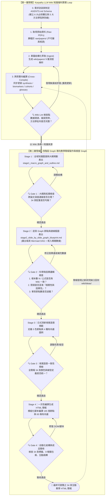

# 作業報告：用 LLM Wiki 做一份教學 HTML 簡報
## 專案主題：敗血症強化學習（Sepsis RL）臨床決策知識庫與「汪博士」三層知識圖譜教學簡報

---

## 📌 步驟一：建立自己的 LLM Wiki（「先討論、後生成」＋ Ingest 9 篇核心文獻）

### 1.1 主題選擇與「先討論、後生成」的需求釐清過程
本專案選擇極具跨領域挑戰性的 **「敗血症（Sepsis）強化學習（Reinforcement Learning, RL）臨床治療決策」** 作為知識庫主題。敗血症休克病患在加護病房（ICU）中面臨「靜脈輸液（IV Fluids）與升壓藥（Vasopressors）該給多少、何時給」的生死兩難。

在建立任何檔案之前，我們嚴格採用 **「先討論、後生成（Clarify First, Generate Later）」** 的互動式訪談流程：
1. **需求訪談（10 題結構化問題釐清）**：在撰寫 `AGENTS.md` 前，先針對知識庫目標受眾、雙主軸範疇（臨床指引 vs. 醫療 AI 模型）、語言策略（台灣繁體中文撰寫、保留英文標準臨床與 AI 縮寫、完整保留英文 PDF 原檔）、單篇論文必抓欄位、跨文獻矛盾審查機制，以及專屬吉祥物 **「汪博士（Dr. Wang，穿博士袍戴圓框眼鏡的柴犬）」** 的視覺融入方式進行確認。
2. **制定 Schema（[`AGENTS.md`](AGENTS.md)）**：經需求確認後，才生成知識庫憲法 `AGENTS.md`，確立 Karpathy LLM Wiki 的三層架構：
   - **第一層 `raw/`（不可變原始文獻層）**：存放原始英文 PDF 論文與素材，Agent 只讀不改。
   - **第二層 `wiki/`（持續複利編譯的知識圖譜層）**：由 Agent 負責維護單篇深度解析與跨篇綜合比較，隨每次 Ingest 自動更新交叉連結。
   - **第三層 `outputs/`（高價值教學與研究產出層）**：將 Wiki 知識編譯為互動式教學 HTML 簡報與研究草稿。

### 1.2 Ingest 文獻規模（共消化 9 篇代表性期刊論文，超越至少 5 篇之要求）
我們共將 **2017–2024 年間 9 篇敗血症強化學習領域最具代表性的英文論文** 存入 `raw/papers/`，並編譯為 **19 個互相連結的 Wiki 頁面**（包含 9 篇單篇深度解析 + 10 篇跨文獻綜合矩陣、MDP 機制、生物標記、資料庫收案漏斗、專有名詞字典與教學指南）：

| 編號 | 論文引用 (Citation) | 發表期刊 / 會議 | 核心方法學突破與地位 |
| :--- | :--- | :--- | :--- |
| **01** | **Raghu et al., 2017a** | *MLHC 2017* | 首度引入 48 維連續狀態空間 + Sparse DAE 編碼 + Dueling Double DQN ($5\times 5$ 動作) |
| **02** | **Raghu et al., 2017b** | *NIPS 2017 Workshop* | 引入 $\Delta\text{SOFA}$ 與 $\tanh(\Delta\text{Lactate})$ 連續生理獎勵塑形，並依 SOFA 分層評估 |
| **03** | **Komorowski et al., 2018** | *Nature Medicine* | **AI Clinician**：K-means 750 離散狀態 + Policy Iteration，完成 eICU 198 家醫院外部驗證 |
| **04** | **Peng et al., 2018** | *MLHC 2018* | 結合 LSTM Autoencoder 歷史壓縮與 Kernel 近鄰安全切換之混合專家模型（MoE） |
| **05** | **Nanayakkara et al., 2022** | *Nat. Biomed. Eng.* | 結合貝氏混合密度網路（BMDN）逆推 7 大心血管生理參數，量化隨機與認知雙重不確定性 |
| **06** | **Yu et al., 2023** | *Biomed. Signal Process. Control* | 提出 DIRL + MT-Dueling ($V_1$ 基線 + $V_2$ 干預分離) 與 DWDR 雙重退化重要性權重評估 |
| **07** | **Lin et al., 2023** | *Digital Health* | 首度採用 DDPG Actor-Critic 實現連續輸液與升壓藥劑量微調，消除離散分箱邊界跳躍 |
| **08** | **Wu et al., 2023** | *Comput. Methods Programs Biomed.* | 提出 WD3QNE：結合雙重優先經驗回放與三大臨床專家硬性安全護欄（預估存活率 $97.81\%$） |
| **09** | **Choi et al., 2024** | *Artif. Intell. Med.* | **HIGHLIGHT**：鎖定中重度敗血症休克（79 維特徵）、結合 Deep SHAP 並揭露 DNR 反向因果陷阱 |

---

## 📊 步驟二：利用 LLM Wiki 製作教學 HTML 簡報

我們以 Wiki 作為唯一事實來源（Single Source of Truth），設計並生成了一份 **34 頁「日式清新（和紙暖白 × 抹茶竹綠 × 柴犬暖杏）三層知識圖譜互動式教學簡報」**：
- **簡報路徑**：[`outputs/html/2026-11-13-sepsis-rl-teaching-slides/2026-11-13-sepsis-rl-and-llm-teaching-slides.html`](outputs/html/2026-11-13-sepsis-rl-teaching-slides/2026-11-13-sepsis-rl-and-llm-teaching-slides.html)
- **讓初學者也能循序漸進理解的三層教學設計**：
  1. **Module A｜從宏觀知識圖譜入門（Slides 01–03）**：
     - 透過「汪博士」導讀與統一的 **5 色節點語意圖例**（🟢 臨床觀測、🟠 AI 模型、🔵 處方與評估、🟣 獎勵與護欄、🔴 因果偏誤陷阱），讓原本不熟悉強化學習與敗血症的讀者先掌握核心全貌。
     - **Slide 02 互動式論文演進圖譜**：讀者可點擊任一論文節點直接跳轉，或切換四大技術演化支線，直覺理解「後一篇論文如何解決前一篇的臨床痛點」。
     - **Slide 03 互動式概念 × 陷阱關聯圖**：點擊 MDP 五元組與四大統計陷阱節點，動態顯示跨文獻比較與「LLM 輔助讀論文的五大教學守則」。
  2. **Module B｜9 篇論文逐篇固定 3 頁深度拆解（Slides 04–30，共 27 頁）**：
     - **第 1/3 頁（臨床背景 ＋ 收案篩選漏斗 DAG）**：頂部設有可點擊的「跨論文定位麵包屑」，下方以有向圖拆解臨床痛點與資料庫篩選流程（含精確樣本數 $N$、Sepsis-3 $T_0$ 時間窗、缺失值插補法）。
     - **第 2/3 頁（MDP 五元組 ＋ 模型閉環架構 DAG）**：左列數學定義，右繪「特徵輸入 $\to$ 潛在狀態編碼 $\to$ RL 決策網路 $\to$ 處方動作與安全護欄 $\to$ 獎勵回饋」閉環圖。
     - **第 3/3 頁（實驗數據表 ＋ 因果偏誤 DAG ＋ 汪博士與 LLM 教學提醒框）**：完整呈現 OPE 數據表，並用因果圖拆解該篇論文的方法學盲點（如 U 型曲線適應症混淆、全零動作獎勵駭客、OPE 97.81% 虛高、DNR 反向因果）。
  3. **Module C｜跨篇因果總結與互動翻卡測驗（Slides 31–34，共 4 頁）**：
     - 包含 9 篇全景對照矩陣、四大離線 RL 陷阱整合結構因果模型（SCM）、未來四大研究空白圖譜，以及 **4 道可點擊翻開解析的隨堂互動測驗卡**。

---

## 🔄 步驟三：說明你的 Loop / Graph 設計

本專案並非使用單一線性指令（「讀 PDF 然後做成簡報」），而是設計了 **「雙層複合閉環（Dual-Loop & Four-Stage Graph Pipeline）」**：外層為 **Wiki 知識複利累積 Loop**，內層為 **四階段 Graph 藍圖驅動之簡報生成與檢查 Graph**。

### 3.1 整體資訊流與檢查管線圖（Mermaid Flowchart）

### 3.2 關鍵設計問答

1. **哪些步驟會重複執行（Iterative Loops）？**
   - **在 Wiki 層（Per-Source Loop）**：「讀取單篇 PDF $\to$ 萃取 6 大必備欄位 $\to$ 更新跨篇比較矩陣（`sepsis-evidence-matrix.md`）與概念專頁 $\to$ 寫入 `log.md`」這個循環會針對每一篇新進論文重複執行。每多讀一篇，舊頁面的跨篇比較表與知識連結就會變得更豐富。
   - **在簡報藍圖層（Per-Paper 3-Slide Graph Loop）**：在 Stage 2 設計 9 篇論文共 27 頁主體時，每篇論文都重複執行標準化的「**3 頁 Graph 拆解模式**」（P.1 跨文獻麵包屑＋收案篩選漏斗 DAG $\to$ P.2 MDP 五元組＋模型閉環 DAG $\to$ P.3 數據表＋因果偏誤 DAG＋汪博士教學提醒框）。
2. **哪些地方需要檢查或重新生成（Validation Gates & Re-generation）？**
   - **Wiki Lint 檢查點**：檢查是否只抄了論文表面的漂亮數字而漏掉「樣本數 $N$、時間窗 $T_0$、缺失值插補法」與「方法學限制」。
   - **Gate 1（大綱拓撲檢查）**：在還沒寫細節前，先檢查 9 篇論文之間的「痛點 $\to$ 解法」有向邊是否正確、每篇分配 3 頁是否足夠深入。
   - **Gate 2（逐頁 Graph 節點與因果檢查 — 最關鍵關卡）**：檢查單頁 Mermaid 圖上的每一條箭頭究竟是「資料流（`──▶`）」、「真實生理因果（`══▶`）」還是「統計混淆偏誤（`✖──▶`）」，若發現把相關性畫成因果關係，直接在 Markdown 藍圖階段重新生成該頁的 DAG。
   - **Gate 4（HTML 自動化計數驗收）**：編譯出 HTML 後，以 Python 腳本自動檢查 `<section class="slide">` 是否剛好 34 頁、`.graph-breadcrumb` 是否剛好 9 個、`.dr-wang-box` 是否完整。
3. **為什麼這樣設計（Design Rationale）？**
   - **解耦「知識理解」、「結構藍圖」與「前端視覺渲染」**：如果讓 LLM 一邊讀 9 篇艱深的醫學 AI 論文、一邊直接寫幾千行的 HTML/CSS，LLM 的注意力會被排版標籤分散，導致內容過度簡化（廢話多、乾貨少）或因果邏輯錯誤。
   - **降低修改成本（Fail Fast in Blueprint）**：在 Stage 1（大綱）與 Stage 2（Mermaid 藍圖）修改一個節點或箭頭只需幾秒鐘；等到確認全部 34 頁的節點與數據都正確無誤後，Stage 4 再一次性編譯為 HTML，就能同時兼顧「學術深度」與「視覺一致性」。

---

## 💡 步驟四：進行反思（基於三次真實迭代的經驗總結）

在本次實際執行過程中，我們的簡報經歷了三次真實演進：**第 1 版（14 頁初步綜合版） $\to$ 第 2 版（擴充每篇文獻頁數與日式風格） $\to$ 第 3 版（導入四階段 Graph 藍圖與 Gate 1–4 檢查機制之 34 頁旗艦版）**。從中我們獲得了極為深刻的工作流反思：

### 1. 哪一個節點最常出錯？
我們發現在整個流程中，有 **兩個節點** 最容易出錯：
- **節點 A（內容萃取與詮釋節點）：LLM 容易陷入「論文摘要的報喜不報憂偏誤（Uncritical Summary Bias）」**
  - **具體案例**：例如 Paper 08（Wu et al., 2023）在摘要宣稱其強化學習模型預估存活率高達 **$97.81\%$**；Paper 01 與 Paper 03 展示了「醫師劑量越接近 AI 死亡率越低」的 **U 型曲線**；Paper 02 在中重度病患出現大量 **`Action (0,0)`（完全不給藥）**。若沒有強制規範方法學審查，AI 在整理重點時會直接照抄「AI 讓敗血症存活率達到 97.81%」，而看不出這是因為硬性護欄把重症死亡病患的 WIS 權重歸零剔除所造成的「統計海市蜃樓」，或是把「瀕死搶救無效（適應症混淆）」與「臨終簽署 DNR 停藥（反向因果）」誤當成 AI 的療效鐵證。
- **節點 B（從文字直接跳到 HTML 簡報的生成節點）：缺乏中間 Graph 藍圖層導致「視覺流於表面、單次生成過大易中斷」**
  - **具體案例**：第一版直接從 Wiki 文字生成 HTML 時，每篇論文只被濃縮成表格裡的一列或簡單幾個方塊，缺乏完整的「收案篩選漏斗圖」與「MDP 閉環架構圖」，使得不熟悉該論文的讀者難以看懂研究全貌；此外，試圖在單一工具呼叫中直接輸出近 20 萬字的 HTML 原始碼時，也容易遇到串流超時中斷（Stream Interruption）。

### 2. 你發現問題後，把檢查往前移到了哪一個步驟？（Shift-Left Testing）
發現上述兩個問題後，我們執行了關鍵的 **「檢查左移（Shift-Left Validation）」**：
1. **將「科學與因果偏誤檢查」左移至 `AGENTS.md` 與 `Wiki Ingest` 階段**：
   - 不等到做簡報時才思考論文有沒有漏洞，而是在一開始的 `AGENTS.md` 第 3、4 節與 `wiki/synthesis/llm-and-rl-teaching-guide.md` 中，就強制規定每篇論文必須拆解「6 大必備欄位」與「4 大離線 RL 方法學陷阱」，讓錯誤的樂觀結論在進入 Wiki 前就被攔截並加上紅色警示框。
2. **將「簡報結構與圖表檢查」從 Stage 4（看 HTML 成品）大幅左移至 Stage 1（大綱 Gate 1）與 Stage 2（逐頁 Mermaid 節點藍圖 Gate 2）**：
   - 在寫出任何一行 HTML/CSS 之前，先產出獨立的 Markdown 藍圖文件（`stage1_macro_graph_and_outline.md` 與 `stage2_slide_by_slide_graph_blueprint.md`），先用 Mermaid 把 34 頁的每一顆節點與每一條因果箭頭畫出來請使用者確認。

### 3. 你有沒有因此修改 workflow / graph？為什麼？
**有！我們對 Workflow 進行了三項結構性升級（並已正式寫入 [`AGENTS.md` 第 7 節](AGENTS.md)）：**
1. **新增「Stage 1 $\to$ Stage 2 $\to$ Stage 3 $\to$ Stage 4」四階段藍圖與人工確認閘門（Human-in-the-Loop Gates）**：
   - **為什麼修改**：原本「需求 $\to$ 直接出 HTML」是一步到位的黑盒子，一旦發現頁數太少或圖表不夠深入，就必須整份 HTML 重寫。改為四階段後，先確認大綱（Gate 1）、再確認 34 頁 Mermaid 節點與數據藍圖（Gate 2）與五色視覺規範（Gate 3），最後才編譯 HTML（Gate 4），讓每一次確認都建立在穩固的地基上。
2. **在簡報內部導入「三層 Graph 視覺化架構（Tier-1 互動全域圖譜 $\to$ Tier-2 跨頁定位麵包屑 $\to$ Tier-3 單頁五色語意 DAG）」**：
   - **為什麼修改**：為了讓初學者不會在 34 頁高密度內容中迷航，我們在每篇論文第 1 頁頂部加上可點擊的「跨論文定位麵包屑（Breadcrumb Graph）」，並用嚴格的 5 種節點顏色區分「🟢 臨床觀測、🟠 AI 模型、🔵 處方評估、🟣 獎勵護欄、🔴 因果陷阱」，讓讀者一看到紅色節點與紅色叉號虛線（`✖──▶`），就能直覺辨識出這是統計偏誤或反向因果陷阱。
3. **在 Stage 4 採用「分段模組化腳本生成 ＋ Python 自動化結構計數驗收」**：
   - **為什麼修改**：將龐大的 34 頁 HTML 拆分為 3 個模組化片段寫入生成腳本，並用腳本自動核對 34 頁 `<section class="slide">`、9 條 `.graph-breadcrumb`、165 個 `.g-node` 與 65 條 `.g-edge`，徹底解決了長文生成串流中斷問題，確保最終簡報 100% 忠實還原 Stage 2 藍圖！
