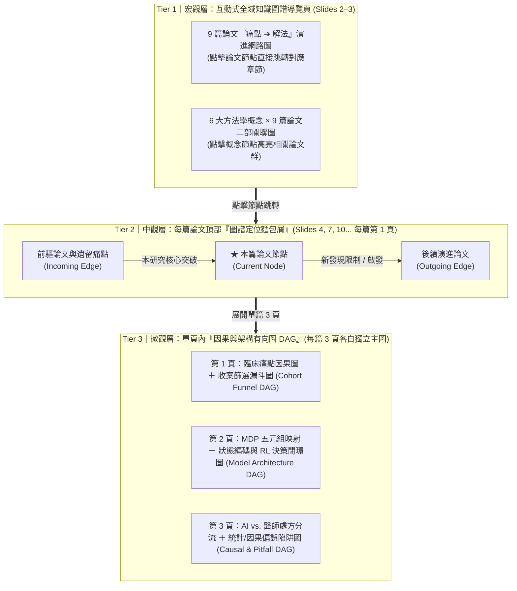
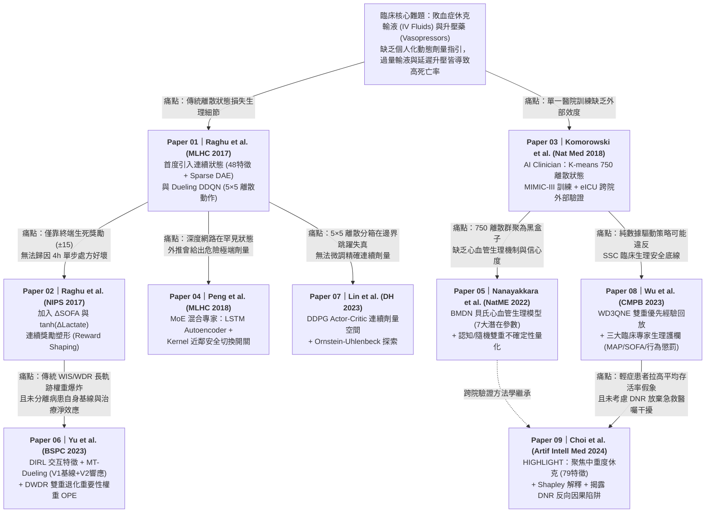
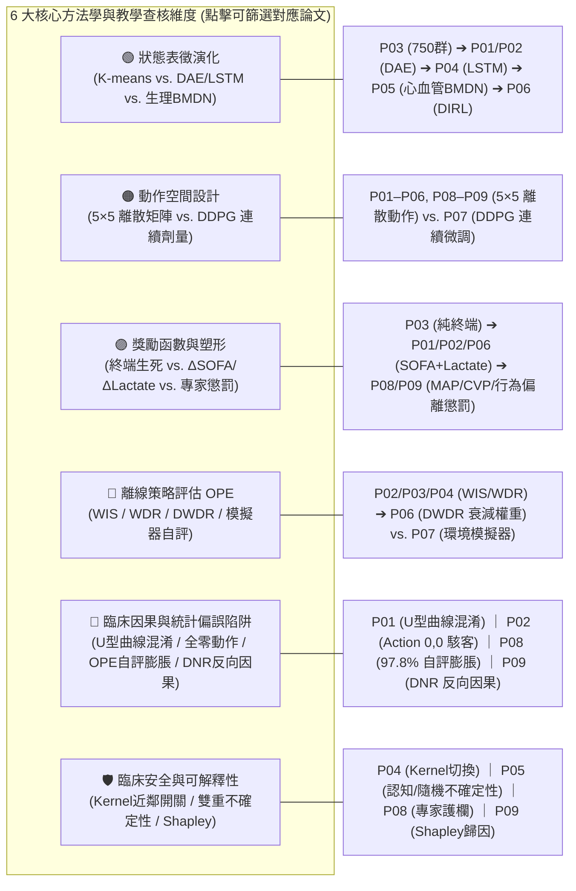

# 【Stage 1 藍圖】敗血症強化學習（Sepsis RL）知識圖譜投影片：全域 Graph 拓撲與 34 頁大綱

> [!IMPORTANT]
> **目前階段：Stage 1（全域知識圖譜與大綱規劃）｜等待 Gate 1 檢查確認**
> 本文件定義整份投影片的**「三層 Graph 架構」**、**「9 篇論文演進知識圖譜」**與**「34 頁逐頁大綱配重」**。確認無誤後，我們才會進入 **Stage 2（逐頁 Graph 節點與連線詳細藍圖）**。

---

## 一、三層 Graph 視覺化架構設計（Three-Tier Graph Architecture）

為了讓整份簡報真正以 **Graph（節點與有向邊網路）** 為核心，我們在簡報中設計三個尺度的 Graph 結構：

---

## 二、全域知識圖譜一：9 篇論文「痛點 ➔ 解法」演進拓撲圖（將作為 Slide 2 互動導覽頁）

這張圖將成為簡報第 2 頁的**互動式主圖譜（Interactive Graph Map）**。在最終 HTML 中，每個節點皆可點擊跳轉至該篇論文的第 1 頁，滑鼠移過連線會顯示**「解決了什麼痛點」**：

---

## 三、全域知識圖譜二：6 大方法學維度 × 9 篇論文關聯圖（將作為 Slide 3 互動概念圖）

在簡報第 3 頁，我們提供以**「方法學概念節點」**為中心的第二張互動導覽圖，並串聯 **LLM 輔助讀論文時最容易遺漏的 5 大教學查核點**：

---

## 四、全簡報 34 頁逐頁大綱總表（Deck Master Outline）

整份簡報規劃為 **34 頁**，其中 **9 篇論文逐篇深度 Graph 拆解佔 27 頁（約 80% 篇幅）**，前後輔以 **互動式知識圖譜導覽（3 頁）** 與 **跨篇因果總結與測驗（4 頁）**：

### 【Module A】開場與互動式全域知識圖譜導覽（Slides 1–3，共 3 頁）

| 頁碼 | 投影片標題 | 核心 Graph 結構與互動功能 | 檢查重點 |
| :--- | :--- | :--- | :--- |
| **Slide 01** | **封面：敗血症強化學習（Sepsis RL）知識圖譜與臨床決策解析** | 汪博士導讀視覺 ＋ 簡報三層 Graph 閱讀指南（如何透過節點、顏色、箭頭讀懂 9 篇論文） | 確立日式清新（和紙 × 抹茶 × 暖杏）基調與圖例說明 |
| **Slide 02** | **【互動知識圖譜 I】2017–2024 九篇敗血症 RL 論文「痛點 ➔ 解法」演進網路** | **互動式 SVG/DOM 網路圖**：9 個論文節點 ＋ 10 條有向演進邊；點擊任一節點直接跳轉該篇第 1 頁；懸停顯示「解決痛點」 | 檢查 9 篇論文的演化因果鏈是否一目了然 |
| **Slide 03** | **【互動知識圖譜 II】MDP 五元組 × 臨床因果陷阱關聯圖 ＆ LLM 教學五大守則** | **概念—論文二部圖**：點擊「狀態、動作、獎勵、OPE、因果陷阱」5 大概念節點，即動態高亮對應的論文卡片與汪博士教學提問 | 將「LLM 教學注意事項」建立為全簡報的審視濾鏡 |

---

### 【Module B】9 篇論文逐篇深度 Graph 拆解（Slides 4–30，每篇固定 3 頁，共 27 頁）

> [!TIP]
> **每篇論文固定 3 頁的標準化 Graph 結構：**
> - **第 1/3 頁（問題與資料流 Graph）**：頂部「跨論文定位麵包屑圖」＋ 左側「臨床痛點因果圖」＋ 右側「收案篩選與時間窗漏斗 DAG（含精確 $N$、$T_0$、排除條件、插補法）」。
> - **第 2/3 頁（MDP 與模型架構 Graph）**：左側「MDP 五元組結構映射卡」＋ 右側「特徵編碼 $\to$ 潛在狀態 $\to$ RL 網路 $\to$ 處方動作 $\to$ 獎勵回傳閉環架構 DAG」。
> - **第 3/3 頁（實驗數據、決策/偏誤因果 Graph 與汪博士教學提醒）**：左側「關鍵實驗與 OPE 對照數據表」＋ 右上「AI vs. 醫師處方分流或方法學偏誤因果 DAG」＋ 右下「🐕 汪博士方法學批判 ＆ 🎓 LLM 教學提醒框」。

| 論文編號 | 頁碼 | 單頁標題 | 單頁核心 Graph 節點與連線重點 |
| :--- | :--- | :--- | :--- |
| **Paper 01** Raghu et al. *(MLHC 2017)* | **Slide 04** | **[P01-1/3] 臨床背景與 MIMIC-III 連續狀態收案漏斗圖** | **定位**：起點論文 ｜ **漏斗 DAG**：MIMIC-III $\to$ Sepsis-3 ($T_0 \pm 24\text{h}/48\text{h}$) $\to$ $N=17,898$ $\to$ 4h 時間步與多頻率插補 |
| | **Slide 05** | **[P01-2/3] Sparse DAE 潛在狀態編碼與 Dueling DDQN 閉環架構圖** | **架構 DAG**：48 維特徵 $\to$ Sparse DAE 壓縮 $\to$ Dueling DDQN 分離 $V(s)$ 與 $A(s,a)$ $\to$ $5\times 5$ 動作 $\to$ $R(s,s')$ 回饋 |
| | **Slide 06** | **[P01-3/3] 四種模型 Ablation 數據與「U 型曲線適應症混淆」因果圖** | **數據**：Linear vs. DQN vs. DDQN vs. Dueling DDQN ($75\%$ 升壓藥減少) ｜ **因果 DAG**：病情惡化 Confounder 如何同時影響劑量差異與死亡率（U 型曲線陷阱） |
| **Paper 02** Raghu et al. *(NIPS 2017)* | **Slide 07** | **[P02-1/3] 長軌跡稀疏獎勵歸因難題與收案/嚴重度分層流程圖** | **定位**：繼承 P01，解決終端獎勵稀疏 ｜ **漏斗 DAG**：$N=17,898$ 切分低/中/高 SOFA 三層以檢驗跨嚴重度表現 |
| | **Slide 08** | **[P02-2/3] $\Delta\text{SOFA}$ 與 $\tanh(\Delta\text{Lactate})$ 獎勵塑形閉環圖** | **架構 DAG**：中間步獎勵 $R_{\text{intermediate}} = -c_0 \mathbb{I}(\text{SOFA}\ge 4) - c_1 \Delta\text{SOFA} - c_2 \tanh(\Delta\text{Lactate})$ 與終端 $\pm 15$ 合成流向圖 |
| | **Slide 09** | **[P02-3/3] WIS/WDR 離線評估數據與「全零動作 (0,0) 獎勵駭客」因果圖** | **數據**：中度 SOFA 死亡率預估降至 $4.6\%$ ｜ **因果 DAG**：中重度群體 AI 集中開立 `(0,0)` 不給藥 $\to$ 規避懲罰卻脫離臨床現實的獎勵駭客機制 |
| **Paper 03** Komorowski et al. *(Nat Med 2018)* | **Slide 10** | **[P03-1/3] AI Clinician 跨院驗證動機與 MIMIC-III / eICU 雙隊列篩選圖** | **定位**：雙隊列外部驗證里程碑 ｜ **雙軌漏斗 DAG**：MIMIC-III ($N=17,083$) 訓練集 vs. eICU ($N=79,073$, 198 家醫院) 外部測試集篩選與排除對照 |
| | **Slide 11** | **[P03-2/3] K-means 750 離散狀態建構與 Policy Iteration 動態規劃管線圖** | **架構 DAG**：48 特徵 $\to$ K-means 750 狀態群 $\to$ 轉移矩陣 $T(s,a,s')$（刪除 $<5$ 次罕見轉移）$\to$ Policy Iteration $\to$ 500 次 Bootstrap 選第 99 百分位安全策略 |
| | **Slide 12** | **[P03-3/3] 雙隊列驗證數據、早期升壓藥分流圖與重要特徵排名** | **數據**：eICU 存活率與劑量差關係 ｜ **分流 DAG**：AI 策略（提早給升壓藥 $30\%$ vs. 醫師 $17\%$、減少輸液）vs. 醫師慣性（先大量輸液）＋ BUN/PaO2/PT 特徵影響 |
| **Paper 04** Peng et al. *(MLHC 2018)* | **Slide 13** | **[P04-1/3] 罕見病況外推風險與入住前後全時程收案篩選圖** | **定位**：繼承 P01，解決 DRL 外推失控 ｜ **漏斗 DAG**：MIMIC-III $N=15,583$（10,000 訓練 / 2,000 驗證 / 3,583 測試），涵蓋廣泛臨床狀態分佈 |
| | **Slide 14** | **[P04-2/3] LSTM Autoencoder 歷史壓縮與 Kernel-DRL MoE 安全開關架構圖** | **架構 DAG**：時序特徵 $\to$ LSTM Autoencoder (32 維歷史表徵) $\to$ 雙軌分支（Kernel 近鄰多數決 vs. Dueling DDQN）$\to$ 依據最小歐氏距離閾值動態切換權重 |
| | **Slide 15** | **[P04-3/3] MoE 離線評估增益數據與「病程時間軸主導權切換」流程圖** | **數據**：MoE WIS 價值全面超越單一 Kernel 或單一 DRL ｜ **時序切換 DAG**：剛入 ICU 常見狀態（Kernel 主導）$\to$ 病況複雜化（DRL 接手）$\to$ 極端罕見狀態（退回醫師近鄰保護） |
| **Paper 05** Nanayakkara et al. *(NatME 2022)* | **Slide 16** | **[P05-1/3] 黑盒子缺乏生理機制與不確定性痛點 ＆ 雙隊列篩選流程圖** | **定位**：突破 P03 黑盒子，結合生理微分模型 ｜ **雙軌漏斗 DAG**：MIMIC-III ($N=20,858$) 與 eICU ($N=23,607$) 收案與觀測向量定義 |
| | **Slide 17** | **[P05-2/3] 貝氏混合密度網路 (BMDN) 7 大心血管參數推論與 D3QN 閉環圖** | **架構 DAG**：可觀測生命徵象 (`HR, SBP, DBP, MAP, CVP`) $\to$ BMDN 逆向推論 7 個隱藏心血管生理參數（心搏量、動脈順應性、周邊阻力等）與雙重不確定性 $\to$ D3QN 決策 |
| | **Slide 18** | **[P05-3/3] 雙重不確定性安全閘門流程圖與跨院 OPE 評估數據** | **數據**：MIMIC-III 與 eICU 預期回報提升 ｜ **安全閘門 DAG**：區分「隨機不確定性 Aleatoric（生理波動）」與「認知不確定性 Epistemic（資料不足）」$\to$ 當認知不確定性過高時觸發人工接管 |
| **Paper 06** Yu et al. *(BSPC 2023)* | **Slide 19** | **[P06-1/3] 傳統 OPE 長軌跡權重爆炸痛點與 $N=19,903$ 收案篩選圖** | **定位**：改良 P01/P02 的價值分離與 OPE 變異數 ｜ **漏斗 DAG**：MIMIC-III $N=19,903$ 收案與 47 維時序生理特徵整理 |
| | **Slide 20** | **[P06-2/3] DIRL 交互式時間摺積與 MT-Dueling DDQN ($V_1+V_2$) 架構圖** | **架構 DAG**：DIRL 雙分支特徵提取 $\to$ MT-Dueling 三輸出頭：$V_1(s)$（病患自身存活基線）＋ $V_2(s)$（治療干預敏感度）＋ $A(s,a)$（動作優勢）合成 $Q(s,a)$ |
| | **Slide 21** | **[P06-3/3] DWDR 雙重退化權重公式流程圖與四種 OPE 指標完整對照表** | **數據**：IS / WIS / WDR / DWDR 四指標與不同行為策略（Random/Physician/BCQ）對比表 ｜ **公式 DAG**：DWDR 如何將連乘權重 $\rho_{1:t}$ 替換為單步退化根號權重以消除長軌跡爆炸 |
| **Paper 07** Lin et al. *(DH 2023)* | **Slide 22** | **[P07-1/3] $5\times 5$ 離散動作邊界跳躍失真痛點與 $N=13,930$ 收案篩選圖** | **定位**：突破 P01–P06 離散分箱限制，進入連續動作空間 ｜ **漏斗 DAG**：MIMIC-III $N=13,930$（11,144 訓練 / 2,786 測試）與 46 特徵前處理 |
| | **Slide 23** | **[P07-2/3] DDPG Actor-Critic 連續劑量微調與 Ornstein-Uhlenbeck 探索圖** | **架構 DAG**：Actor $\mu(s|\theta^\mu)$ 直接輸出連續輸液與升壓藥劑量 $+$ OU 慣性雜訊 $\to$ Critic $Q(s,a|\theta^Q)$ 評估價值並透過確定性策略梯度 $\nabla_a Q \cdot \nabla_{\theta^\mu}\mu$ 更新 |
| | **Slide 24** | **[P07-3/3] 低/中/高 SOFA 連續劑量分佈表與「模擬器自評偏差」因果圖** | **數據**：高 SOFA 組預估死亡率由 $52.5\%$ 降至 $29.6\%$ ｜ **因果 DAG**：以神經網路環境模擬器（Simulator）取代真實反事實評估時，「模型討好模擬器」的閉環自評偏差 |
| **Paper 08** Wu et al. *(CMPB 2023)* | **Slide 25** | **[P08-1/3] 純數據驅動違反臨床指引風險與 $N=20,943$ 收案篩選圖** | **定位**：為 D3QN 加上人類臨床專家硬性安全護欄 ｜ **漏斗 DAG**：MIMIC-III $N=20,943$（80% 訓練 / 10% 驗證 / 10% 測試）與 45 特徵篩選 |
| | **Slide 26** | **[P08-2/3] WD3QNE 雙重優先經驗回放與三大臨床專家生理護欄架構圖** | **架構 DAG**：TD-error + 生存結果雙重優先抽樣 $\to$ WD3QNE 網路 $\to$ **三大臨床安全防護罩**：① 末期 $\text{SOFA}\le 3$ 清零輸液、② $\text{MAP}>65$ 清零升壓藥、③ 偏離醫師處方懲罰項 |
| | **Slide 27** | **[P08-3/3] 預估存活率 $97.81\%$ 數據表與「行為懲罰導致 OPE 自評虛高」因果圖** | **數據**：D3QN ($92.04\%$) $\to$ +行為懲罰 ($96.15\%$) $\to$ WD3QNE ($97.81\%$) ｜ **因果 DAG**：加入「偏離醫師處方懲罰」為何會讓 $\pi_e \approx \pi_b$，進而造成重要性權重 $\rho \approx 1$ 與存活率虛高假象 |
| **Paper 09** Choi et al. *(Artif Intell Med 2024)* | **Slide 28** | **[P09-1/3] 中重度休克同質化治療盲點與 HIGHLIGHT 雙隊列 79 特徵篩選圖** | **定位**：聚焦真正高死亡率之中重度休克子群 ｜ **雙軌漏斗 DAG**：篩選 $\text{Lactate}>2$ 或需升壓藥且 $\text{SOFA}\ge 6$ 之重症群（MIMIC-III $N=4,124$ / eICU $N=3,815$），擴充至 79 維特徵 |
| | **Slide 29** | **[P09-2/3] 雙通道臨床安全懲罰獎勵函數與 Deep Shapley 特徵歸因架構圖** | **架構 DAG**：79 維特徵 $\to$ DDDQN $\to$ 獎勵函數同時懲罰「輸液過載（$\text{CVP}>12$ 或體重增加 $>5\%$）」與「升壓過度（$\text{MAP}>85$）」$\to$ Deep SHAP 解析各特徵對劑量貢獻 |
| | **Slide 30** | **[P09-3/3] 跨院外部驗證數據與「DNR 放棄急救醫囑反向因果陷阱」圖解** | **數據**：MIMIC-III ($14.2\%$ vs $28.5\%$) 與 eICU ($16.8\%$ vs $24.1\%$) ｜ **因果 DAG**：臨終簽署 DNR $\to$ 醫師停止升壓藥且病患死亡 $\to$ AI 誤以為「不給藥導致死亡」或「給藥必死」的未觀測混淆變數陷阱 |

---

### 【Module C】跨篇知識圖譜綜合收斂與隨堂互動檢測（Slides 31–34，共 4 頁）

| 頁碼 | 投影片標題 | 核心 Graph 結構與內容 | 檢查重點 |
| :--- | :--- | :--- | :--- |
| **Slide 31** | **【全景對照表】9 篇敗血症 RL 論文「狀態 × 動作 × 獎勵 × OPE × 臨床限制」總矩陣** | 結構化橫向比較總表，並標示每篇論文在知識圖譜中的色票標籤 | 提供一頁式快速查閱的完整數據與方法學索引 |
| **Slide 32** | **【方法學核心總結】敗血症離線 RL 四大因果與評估陷阱總網路圖** | **四大陷阱整合 DAG**：將 ① U 型曲線適應症混淆、② 全零動作獎勵駭客、③ OPE 權重爆炸與自評膨脹、④ DNR 未觀測反向因果，整合於單一臨床資料生成因果圖 (SCM) 中 | 幫學生建立批判性閱讀醫療 AI 論文的完整防禦網 |
| **Slide 33** | **【未來研究藍圖】從 9 篇文獻缺口推導出的 4 大新研究方向 ＆ LLM Wiki 協作流** | **研究演化 Graph**：現有缺口節點 $\to$ 4 大未來方向（動態時間視窗、強化版安全防護、Causal RL 因果反事實、多模態臨床筆記融合）＋ Karpathy LLM Wiki 知識複利閉環圖 | 連結回本專案 LLM Wiki 的核心精神與未來研究題目發想 |
| **Slide 34** | **【汪博士隨堂互動測驗】4 道臨床 AI 與 LLM 讀論文盲點翻卡挑戰** | 4 張互動翻轉卡片（點擊揭曉汪博士解析）：涵蓋 U 型曲線、OPE 97.8% 迷思、全零動作駭客、DNR 混淆變數 | 課堂收尾互動與學習成效檢核 |

---

## 五、🔍 檢查點 Gate 1：請確認以下 4 個問題（確認後進入 Stage 2）

在我們開始撰寫 **Stage 2（34 頁逐頁的詳細節點、連線與數據藍圖）** 之前，請協助檢查以下 4 點：

1. **總頁數與配重（34 頁）**：
   - Module A（開場＋2 張互動知識圖譜導覽頁，共 3 頁）
   - Module B（9 篇論文 × 每篇 3 頁深度 Graph 拆解，共 27 頁）
   - Module C（跨篇總表＋四大因果陷阱總圖＋未來研究圖譜＋隨堂測驗，共 4 頁）
   - 👉 **這樣的 34 頁結構與配重是否剛好？**
2. **兩張「互動式知識圖譜導覽頁」（Slide 2 論文演進網路圖 ＆ Slide 3 概念關聯圖）**：
   - 👉 **這兩張全域 Graph 的節點與連線邏輯是否清楚？有沒有您想額外加入的跨論文比較維度？**
3. **每篇論文固定 3 頁的單頁 Graph 分工**：
   - 第 1 頁：`跨論文定位麵包屑` ＋ `臨床痛點 & 收案篩選漏斗 DAG`
   - 第 2 頁：`MDP 五元組映射` ＋ `特徵編碼與 RL 決策閉環架構 DAG`
   - 第 3 頁：`實驗數據表` ＋ `處方分流 / 統計因果偏誤 DAG` ＋ `汪博士方法學批判 & LLM 教學提醒`
   - 👉 **這 3 頁的 Graph 角色分工是否符合您的教學需求？**
4. **進入 Stage 2（逐頁 Graph 節點與連線藍圖）的檢查方式**：
   - 由於 9 篇論文共 27 頁核心細節非常豐富，進入 Stage 2 時，您希望我**「一次建立完整的 34 頁逐頁 Graph 藍圖 Markdown 文件」**，還是**「分三次（每次 3 篇論文，共 9 頁）產出藍圖讓您分段細看」**？
