# 【Stage 2 & 3 藍圖】34 頁逐頁 Graph 節點與連線完整設計 ＋ 日式清新視覺語意規範

> [!IMPORTANT]
> **目前階段：Stage 2（逐頁 Graph 節點與連線藍圖）＆ Stage 3（視覺語意規範預檢）｜等待 Gate 2/3 檢查確認**
> 本文件完整列出 **Slide 01 至 Slide 34** 每一頁的：
> 1. **跨論文知識圖譜定位（Breadcrumb Edges）**
> 2. **單頁核心 Graph（Mermaid 節點與有向邊拓撲圖）**
> 3. **精確科學數據、MDP 公式與汪博士／LLM 教學提醒**
>
> 確認本藍圖通過後，我們將進入最終 **Stage 4：一次性編譯生成含互動知識圖譜的日式清新 HTML 投影片**。

---

## 🎨 零、Stage 3 預檢：日式清新 Graph 視覺語意規範（Visual Semantics Legend）

在全簡報 34 頁的所有 Graph 中，我們嚴格採用同一套**「和紙暖白 × 抹茶竹綠 × 柴犬暖杏」色票與箭頭語意**，讓聽眾一看到節點顏色與線條樣式，就能直覺分辨其科學角色：

| 視覺元素 | 類別名稱 | 日式色票與樣式 | 代表之科學／臨床語意 |
| :--- | :--- | :--- | :--- |
| 🟢 **節點 (Node)** | **臨床觀測與收案節點 (Observation / Cohort)** | 抹茶竹綠底 `#EBF3ED`、深竹綠框 `#4A7C59` | MIMIC-III / eICU 原始資料庫、生命徵象、檢驗值 (`Lactate`, `SOFA`, `MAP`)、收案篩選條件 |
| 🟠 **節點 (Node)** | **特徵編碼與 AI 模型節點 (Encoder / RL Agent)** | 柴犬暖杏底 `#FDF3E7`、暖杏框 `#D9822B` | 狀態壓縮網路 (`Sparse DAE`, `LSTM`, `BMDN`, `K-means`, `DIRL`) 與 RL 決策網路 (`Dueling DDQN`, `DDPG`, `WD3QNE`) |
| 🔵 **節點 (Node)** | **動作處方與評估結果節點 (Action / OPE Outcome)** | 靛青藍底 `#EBF2F7`、靛青框 `#3B6E8C` | 輸液與升壓藥劑量空間 (`5×5 離散矩陣`、連續劑量)、OPE 評估指標 (`WIS`, `WDR`, `DWDR`) 與預估存活率 |
| 🟣 **節點 (Node)** | **獎勵塑形與專家知識節點 (Reward / Prior Guardrail)** | 紫藤淡底 `#F3EFF7`、紫藤框 `#7A5C91` | 終端生死獎懲 ($\pm 15$)、生理獎勵塑形 ($\Delta\text{SOFA}$, $\Delta\text{Lactate}$)、臨床專家安全護欄 |
| 🔴 **節點 (Node)** | **因果偏誤與方法學陷阱節點 (Confounder / Pitfall)** | 茜草磚紅底 `#FBECE9`、磚紅框 `#C85A48` | 適應症混淆 (`Confounding by Indication`)、全零動作獎勵駭客、`DNR` 反向因果、模擬器或 OPE 自評虛高 |
| `──▶` **實線邊** | **資料流與順向計算邊 (Data / Forward Flow)** | 深炭墨灰 `#4A453E` (2px 實線) | 資料前處理步驟、神經網路前向傳播、狀態轉移 |
| `══▶` **粗實線邊** | **臨床因果作用邊 (Clinical Causal Effect)** | 抹茶竹綠 `#4A7C59` (3.5px 粗線) | 處方介入對生理指標或存活率的真實生理因果路徑 |
| `-.->` **虛線邊** | **獎勵回傳與梯度更新邊 (Reward / Feedback Loop)** | 柴犬暖杏 `#D9822B` (2px 虛線) | 獎勵函數回饋、TD-error 優先抽樣、Actor-Critic 梯度更新 |
| `✖──▶` **紅警示邊** | **偏誤干擾或安全攔截邊 (Bias / Safety Block)** | 茜草磚紅 `#C85A48` (2.5px 虛線/叉號) | 未觀測混淆變數干擾、極端不確定性觸發人工接管、臨床安全護欄強制清零 |

---

## 🗺️ 一、【Module A】開場與互動式全域知識圖譜（Slides 01–03）

### Slide 01｜封面：敗血症強化學習（Sepsis RL）知識圖譜與臨床決策深度解析
- **版面配置**：左 60% 簡報主標題、副標題与「三層 Graph 閱讀指南卡片」；右 40% 汪博士歡迎插圖（`dr_wang_01_greeting_sweat.jpg`）與圖例色票卡。
- **單頁核心 Graph（三層閱讀導覽圖）**：


---

### Slide 02｜【互動知識圖譜 I】2017–2024 九篇敗血症 RL 論文「痛點 ➔ 解法」演進網路圖
- **互動功能設計**：
  - 畫面上呈現 9 個可點擊的**論文節點卡片**與 10 條標註「解決痛點」的**有向SVG連線**。
  - **點擊任一論文節點**：直接跳轉至該篇論文的第 1 頁（例如點擊 `P05 Nanayakkara 2022` 跳轉至 Slide 16）。
  - **頂部篩選按鈕**：可一鍵高亮「基礎架構奠基群 (2017–2018)」、「生理與不確定性群 (2018–2022)」、「OPE 與連續控制改良群 (2023)」、「專家護欄與重症聚焦群 (2023–2024)」。
- **單頁核心 Graph（9 篇演進 DAG）**：
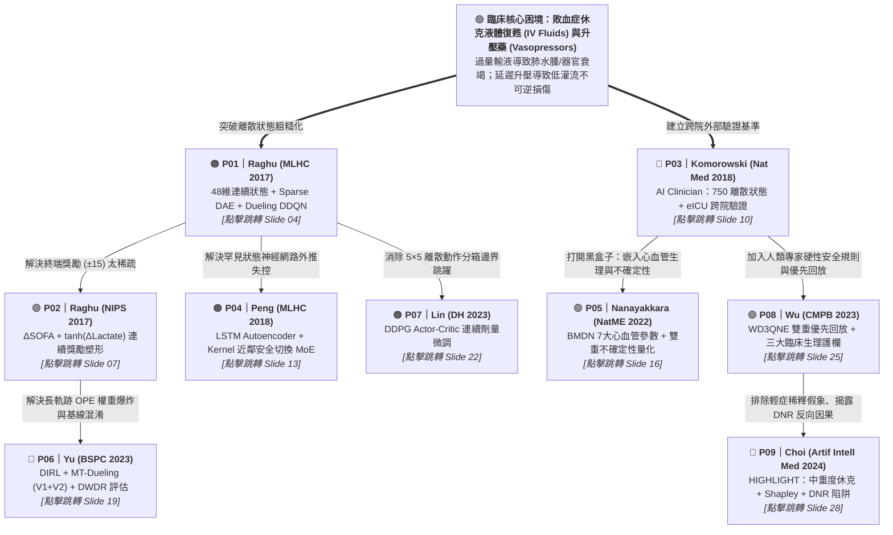

---

### Slide 03｜【互動知識圖譜 II】MDP 五元組 × 臨床因果陷阱關聯圖 ＆ LLM 教學五大守則
- **互動功能設計**：左側為 6 個核心方法學概念節點（點擊切換），右側動態顯示該概念連結的論文清單與**「🎓 汪博士 LLM 教學查核問題」**。
- **單頁核心 Graph（概念—論文—教學守則映射圖）**：
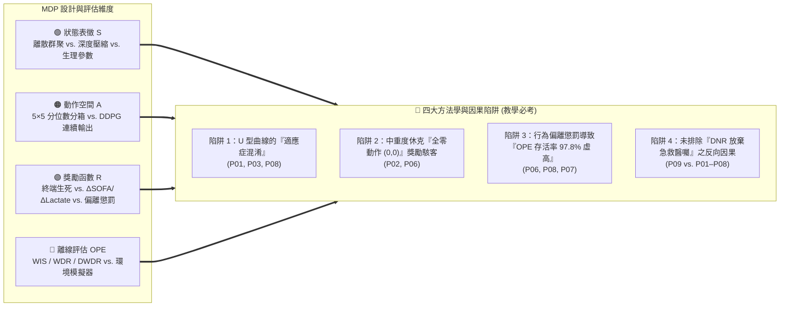

---

## 📚 二、【Module B】9 篇論文逐篇深度 Graph 拆解（Slides 04–30，共 27 頁）

---

### 🔹 Paper 01｜Raghu et al. (MLHC 2017) — *Continuous State-Space Models for Optimal Sepsis Treatment*

#### Slide 04｜[P01-1/3] 臨床背景與 MIMIC-III 連續狀態收案篩選漏斗圖
- **🧭 頂部知識圖譜定位（Breadcrumb）**：`[傳統離散狀態 MDP (損失生理細節)] ──(本研究突破：引入 48 維連續狀態與 Dueling DDQN)──▶ ★【P01 Raghu MLHC 2017】 ──(啟發後續)──▶ [P02 獎勵塑形 / P04 MoE 安全切換 / P07 連續動作]`
- **單頁核心 Graph（痛點因果 ＋ 收案篩選漏斗 DAG）**：
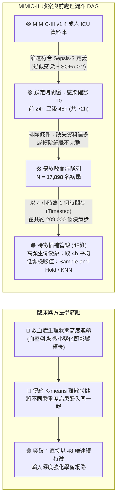

#### Slide 05｜[P01-2/3] Sparse DAE 潛在狀態編碼與 Dueling DDQN 閉環架構圖
- **MDP 五元組結構卡**：
  - $\mathcal{S}$：48 維連續生理特徵（或經 Sparse Denoising Autoencoder 壓縮之 64 維潛在表徵 $z_t$）。
  - $\mathcal{A}$：$5 \times 5 = 25$ 種離散動作（IV Fluids 與 Vasopressors 各自依非零劑量四分位數切為 Level 0–4）。
  - $R$：中間步 $R_t = -c_0\mathbb{I}(s_t^{\text{SOFA}}=s_{t+1}^{\text{SOFA}}\text{ & }>0) - c_1(s_{t+1}^{\text{SOFA}}-s_t^{\text{SOFA}}) - c_2\tanh(s_{t+1}^{\text{Lac}}-s_t^{\text{Lac}})$；終端步存活 $+15$、死亡 $-15$。
  - $\gamma = 0.99$，時間步 $\Delta t = 4\text{h}$。
- **單頁核心 Graph（模型架構閉環 DAG）**：
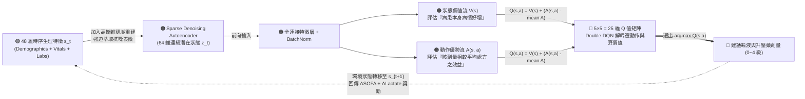

#### Slide 06｜[P01-3/3] 四種模型 Ablation 數據與「U 型曲線適應症混淆」因果圖
- **關鍵實驗數據表（4 組架構 Ablation 對照）**：
  - `Linear Q-Network` vs. `Vanilla DQN` vs. `Double DQN (DDQN)` vs. `Dueling DDQN + Sparse DAE`：Dueling DDQN 成功抑制過高 Q 值高估，且在約 $75\%$ 需要升壓藥的情境中建議較保守劑量，同時在多數情境維持或略增液體補充。
- **單頁核心 Graph（U 型曲線背後的「適應症混淆 Confounding by Indication」因果 DAG）**：
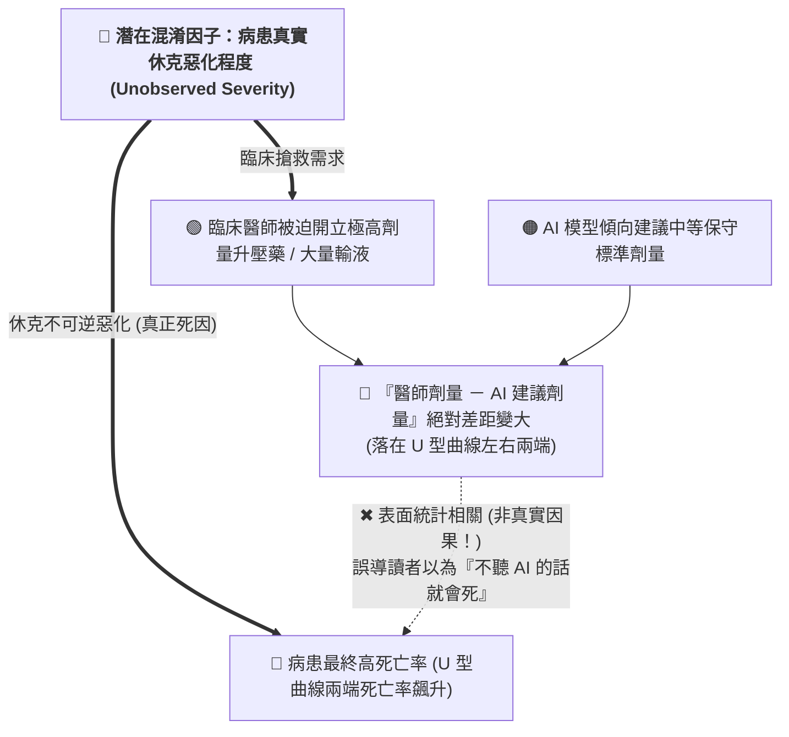
- **🐕 汪博士方法學批判 ＆ 🎓 LLM 教學提醒**：
  - **方法學批判**：U 型曲線（劑量接近 AI 時死亡率最低、偏離越遠死亡率越高）在幾乎所有敗血症 RL 論文中都會出現，但當醫師給 0、AI 也建議 0 的病人本來就是**輕症低風險群**；當醫師狂給升壓藥而偏離 AI 時，病人往往處於**瀕死休克**。
  - **LLM 教學守則**：要求學生向 LLM 提問：「*請畫出 U 型曲線背後的因果有向無環圖（DAG），並解釋為什麼『劑量偏離 AI 越遠死亡率越高』不能直接證明 AI 處方優於醫師？*」

---

### 🔹 Paper 02｜Raghu et al. (NIPS 2017 Workshop) — *Deep Reinforcement Learning for Sepsis Treatment*

#### Slide 07｜[P02-1/3] 長軌跡稀疏獎勵歸因難題與嚴重度分層篩選流程圖
- **🧭 頂部知識圖譜定位**：`[P01 Raghu MLHC 2017] ──(深化獎勵塑形與低/中/高 SOFA 分層離線評估)──▶ ★【P02 Raghu NIPS 2017】 ──(遺留長軌跡 OPE 權重爆炸與全零動作問題)──▶ [P06 Yu 2023 DWDR]`
- **單頁核心 Graph（信用分配難題 ＋ SOFA 三層分層漏斗 DAG）**：
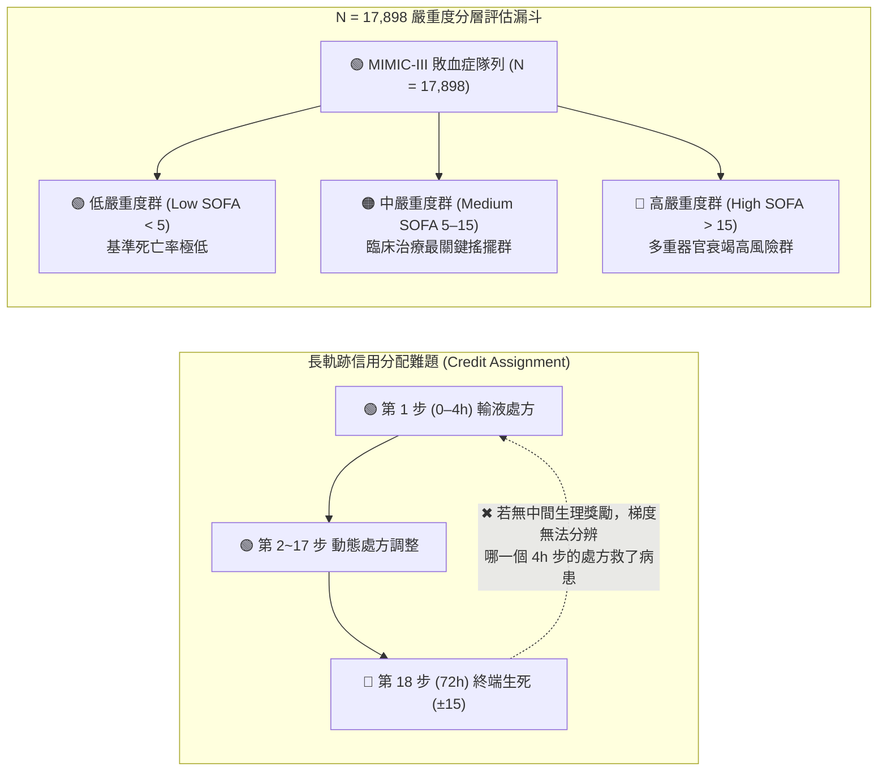

#### Slide 08｜[P02-2/3] $\Delta\text{SOFA}$ 與 $\tanh(\Delta\text{Lactate})$ 生理獎勵塑形閉環圖
- **MDP 獎勵塑形精確數學公式**：
  $$R_{\text{intermediate}}(s_t, s_{t+1}) = -0.025 \cdot \mathbb{I}(s_{t+1}^{\text{SOFA}} = s_t^{\text{SOFA}} \land s_{t+1}^{\text{SOFA}}>0) - 0.125 \cdot (s_{t+1}^{\text{SOFA}} - s_t^{\text{SOFA}}) - 2.0 \cdot \tanh(s_{t+1}^{\text{Lactate}} - s_t^{\text{Lactate}})$$
- **單頁核心 Graph（三分支生理獎勵合成與 Q 值更新閉環 DAG）**：
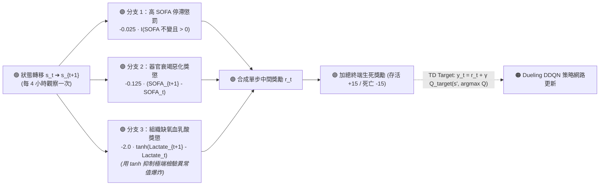

#### Slide 09｜[P02-3/3] WIS / WDR 離線評估數據與「全零動作 `(0,0)` 獎勵駭客」因果圖
- **關鍵實驗數據表**：
  - 在中度嚴重群（SOFA 5–15），預估住院死亡率接近 AI 最佳劑量處可降至 **$4.6\%$**（整體隊列基準死亡率約 $14.3\%$）；WDR（Weighted Doubly Robust）估計之策略價值顯著高於醫師行為策略。
- **單頁核心 Graph（中重度群體 AI 傾向開立 `Action (0,0)` 的獎勵駭客機制 DAG）**：
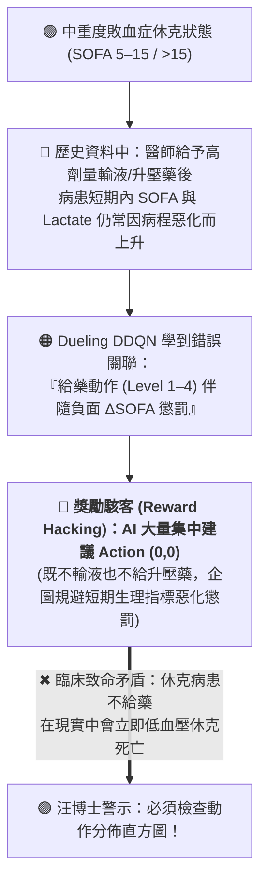
- **🐕 汪博士方法學批判 ＆ 🎓 LLM 教學提醒**：
  - **方法學批判**：只看 OPE 分數（WIS/WDR 很高）會以為模型超棒，但一看 Action Distribution 就會發現模型在中重度休克病患身上竟然最愛選 `(0,0)` 不作為！
  - **LLM 教學守則**：訓練學生看 RL 論文時，絕不能只讓 LLM 摘要「模型分數贏過醫師」，必須強制要求 LLM 檢查「**Action Distribution（動作分佈圖）在重症亞群是否出現反臨床直覺的零劑量聚集**」。

---

### 🔹 Paper 03｜Komorowski et al. (Nature Medicine 2018) — *The Artificial Intelligence Clinician*

#### Slide 10｜[P03-1/3] AI Clinician 跨院驗證動機與 MIMIC-III / eICU 雙隊列篩選漏斗圖
- **🧭 頂部知識圖譜定位**：`[單一醫學中心研究] ──(建立 750 離散狀態 MDP + 198 家醫院 eICU 跨院外部驗證)──▶ ★【P03 Komorowski Nat Med 2018】 ──(啟發後續)──▶ [P05 心血管生理模型 / P08 臨床專家護欄]`
- **單頁核心 Graph（雙資料庫獨立訓練與外部驗證篩選漏斗 DAG）**：
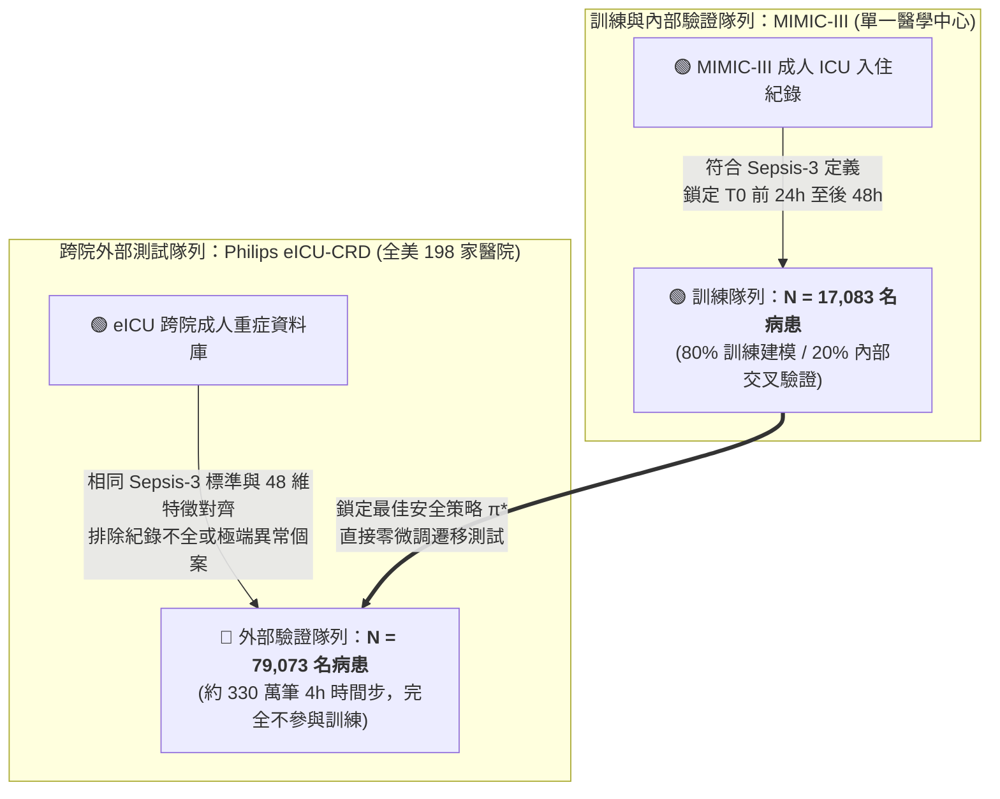

#### Slide 11｜[P03-2/3] K-means 750 離散狀態建構與 500 次 Bootstrap Policy Iteration 管線圖
- **MDP 五元組結構卡**：
  - $\mathcal{S}$：48 維生理變數經 **K-means 聚類為 $750$ 個離散狀態** + 2 個終端吸收態（90 天存活 / 死亡）。
  - $\mathcal{A}$：$5 \times 5 = 25$ 種離散劑量組合。
  - $R$：**純終端獎勵**（90 天存活 $+100$、死亡 $-100$；中間步獎勵皆為 $0$）。
  - $\gamma = 0.99$，演算法採用動態規劃 **Policy Iteration**。
- **單頁核心 Graph（500 次 Bootstrap 建構轉移矩陣與保守安全策略選擇 DAG）**：


#### Slide 12｜[P03-3/3] 雙隊列驗證數據、早期升壓藥處方分流圖與重要特徵排名
- **關鍵實驗數據表**：
  - **處方分佈差異**：AI Clinician 建議給予升壓藥的比例為 **$30\%$**（臨床醫師僅 **$17\%$**），且 AI 建議的平圴輸液量顯著低於醫師（避免液體過載 Fluid Overload）。
  - **外部驗證結果**：在 eICU $N=79,073$ 中，實際接受劑量最接近 AI 建議之病患群享有最低之 90 天與院內死亡率。
- **單頁核心 Graph（AI 策略 vs. 臨床醫師處方分流比較 ＋ 隨機森林特徵重要性 DAG）**：
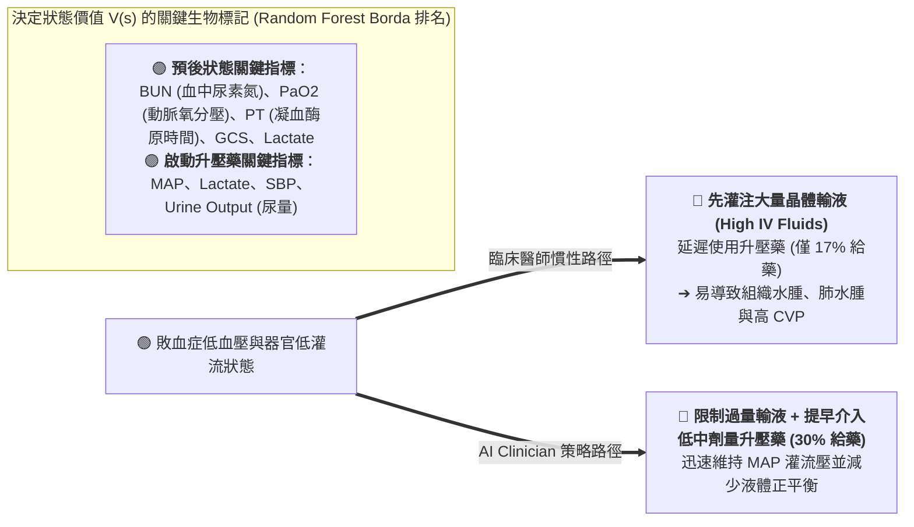
- **🐕 汪博士方法學批判 ＆ 🎓 LLM 教學提醒**：
  - **方法學批判**：K-means 硬分 750 群會產生「狀態邊界跳躍」與馬可夫假設違背（忽略病程動態趨勢）；且挑選 WIS 95% 下界最高者會偏向「與醫師行為重疊度高」的保守策略。
  - **LLM 教學守則**：引導學生區分「**決定病患存活狀態價值 $V(s)$ 的慢指標（如 BUN、PT、PaO2）**」與「**觸發單步用藥動作 $A(s,a)$ 的快指標（如 MAP、Lactate）**」，避免 LLM 把兩者混為一談。

---

### 🔹 Paper 04｜Peng et al. (MLHC 2018) — *Improving Sepsis Treatment Strategies by Combining Deep and Kernel-Based RL*

#### Slide 13｜[P04-1/3] 罕見病況深度網路外推風險與 $N=15,583$ 全時程收案篩選圖
- **🧭 頂部知識圖譜定位**：`[P01 Raghu 2017 (純 DRL 在罕見狀態外推危險)] ──(引入 LSTM 歷史壓縮 + Kernel 近鄰安全切換 MoE)──▶ ★【P04 Peng MLHC 2018】 ──(啟發後續)──▶ [P05 貝氏認知不確定性閘門]`
- **單頁核心 Graph（純 DRL 外推痛點 ＋ 收案切分漏斗 DAG）**：
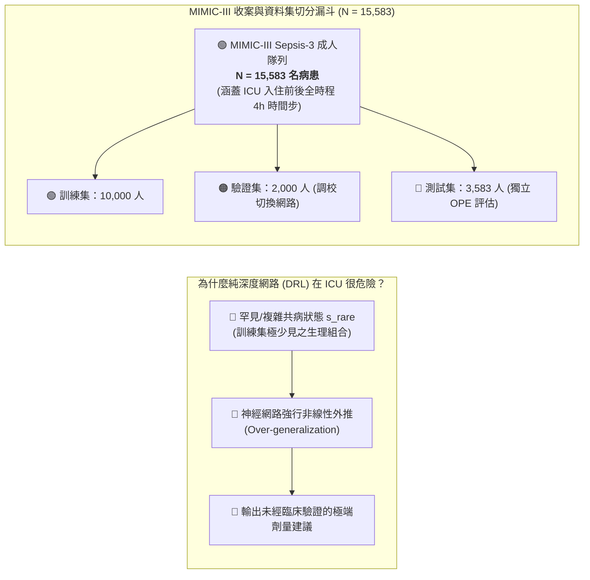

#### Slide 14｜[P04-2/3] LSTM Autoencoder 歷史壓縮與 Kernel-DRL 混合專家 (MoE) 架構圖
- **MDP 關鍵設計**：
  - 利用 **LSTM Autoencoder** 將從入住到當下 $t$ 的完整時序歷史 $h_t = (o_1, a_1, \dots, o_t)$ 壓縮為 **32 維固定長度潛在向量 $z_t$**（解決非馬可夫問題 POMDP）。
- **單頁核心 Graph（MoE 雙專家根據近鄰距離動態切換架構 DAG）**：
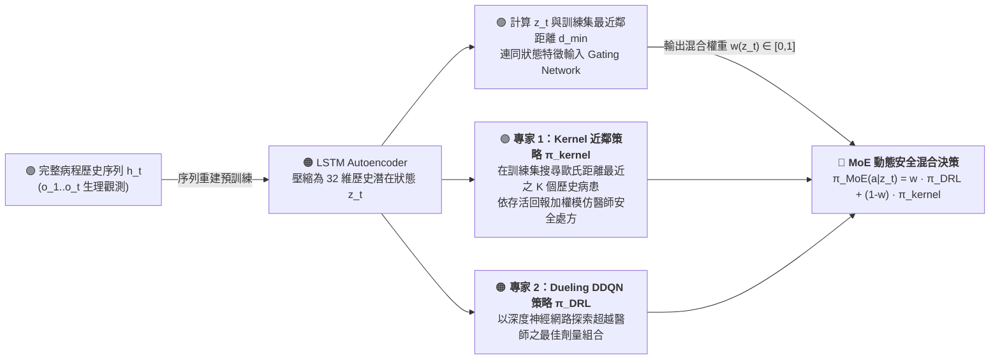

#### Slide 15｜[P04-3/3] MoE 離線評估增益數據與「病程時間軸主導權動態轉移」流程圖
- **關鍵實驗數據表**：
  - 在測試集（$N=3,583$）1,000 次 Bootstrap WIS 評估中：**MoE 混合策略價值 > 純 Dueling DDQN > 純 Kernel 策略 > 臨床醫師表現**。
- **單頁核心 Graph（隨 ICU 住院時間推移之專家主導權轉移流程圖）**：
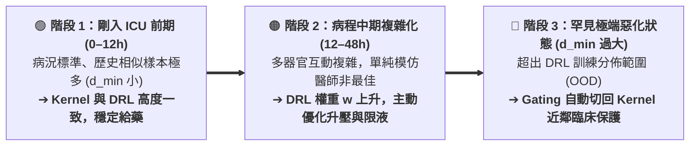
- **🐕 汪博士方法學批判 ＆ 🎓 LLM 教學提醒**：
  - **方法學批判**：LSTM Autoencoder 雖解決了單步 K-means 遺忘歷史的問題，但歐氏距離在 32 維壓縮空間中是否能真實反映「臨床生理相似度」，仍受限於重建損失函數未考慮動作敏感度。
  - **LLM 教學守則**：請學生用 LLM 比較「**Peng 2018 的最近鄰距離 $d_{\min}$**」與「**Nanayakkara 2022 的貝氏認知不確定性**」兩種安全煞車機制的異同。

---

### 🔹 Paper 05｜Nanayakkara et al. (Nature Biomedical Engineering 2022) — *Unifying Cardiovascular Modelling with DRL*

#### Slide 16｜[P05-1/3] 黑盒子缺乏生理機制與不確定性痛點 ＆ 雙隊列篩選流程圖
- **🧭 頂部知識圖譜定位**：`[P03 Komorowski 2018 (純數據黑盒子)] ──(結合心血管常微分方程生理模型 + 貝氏雙重不確定性)──▶ ★【P05 Nanayakkara NatME 2022】 ──(啟發後續)──▶ [具生理可解釋性之安全決策支援]`
- **單頁核心 Graph（黑盒子臨床信任危機 ＋ MIMIC-III / eICU 雙隊列篩選漏斗 DAG）**：
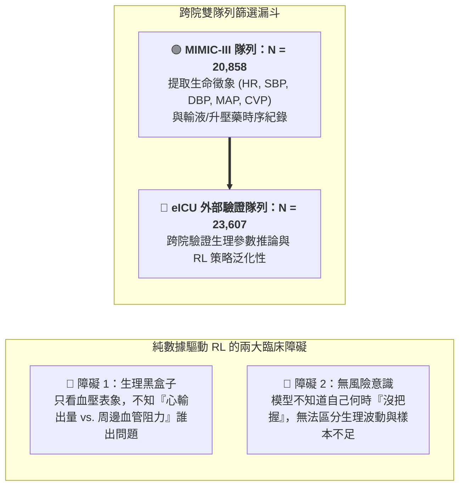

#### Slide 17｜[P05-2/3] 貝氏混合密度網路 (BMDN) 7 大心血管參數推論與不確定性感知 D3QN 閉環圖
- **7 大隱藏心血管生理參數 $\theta_t$**：心搏量（Stroke Volume）、心率基準、動脈順應性（Arterial Compliance）、總周邊血管阻力（TPR）、靜脈順應性、無壓力容積、心肌收縮力。
- **單頁核心 Graph（觀測生命徵象 $\to$ BMDN 逆推生理參數與雙重不確定性 $\to$ D3QN 閉環 DAG）**：
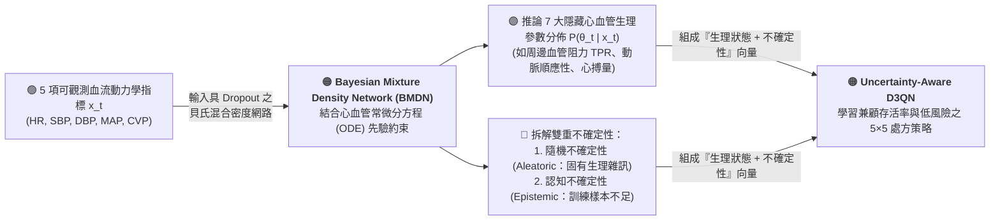

#### Slide 18｜[P05-3/3] 雙重不確定性臨床安全閘門流程圖與跨院 OPE 數據
- **關鍵實驗數據表**：
  - BMDN 推論之心輸出量與周邊阻力高度符合敗血症「高動力型溫暖休克（低阻力、高心輸出）」與「低動力型寒冷休克」臨床表型；在 MIMIC-III 與 eICU 之加權雙重穩健（WDR）評估均優於無生理模型之基準 RL。
- **單頁核心 Graph（雙重不確定性分流決策與臨床接管安全閘門 DAG）**：
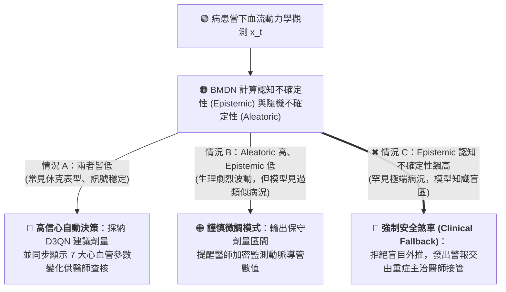
- **🐕 汪博士方法學批判 ＆ 🎓 LLM 教學提醒**：
  - **方法學批判**：心血管簡化集總參數模型（Lumped-parameter model）假設短期內血管物理特性平穩，對於合併嚴重心律不整或主動脈氣球幫浦（IABP）支持之患者可能產生參數不可識別性（Non-identifiability）。
  - **LLM 教學守則**：務必讓學生能清楚口述區分 **Aleatoric Uncertainty（資料本身的固有生理波動，加再多訓練資料也消不掉）** 與 **Epistemic Uncertainty（模型沒見過這類病人，必須煞車交還給醫師）**。

---

### 🔹 Paper 06｜Yu et al. (Biomedical Signal Processing and Control 2023) — *Towards More Efficient and Robust Evaluation*

#### Slide 19｜[P06-1/3] 傳統 OPE 長軌跡權重爆炸痛點與 $N=19,903$ 收案篩選圖
- **🧭 頂部知識圖譜定位**：`[P01/P02 (單一 V(s) 混淆基線 + WIS/WDR 長軌跡權重爆炸)] ──(提出 DIRL + MT-Dueling V1/V2 分離 + DWDR 評估)──▶ ★【P06 Yu BSPC 2023】`
- **單頁核心 Graph（傳統重要性抽樣連乘崩潰痛點 ＋ $N=19,903$ 收案漏斗 DAG）**：
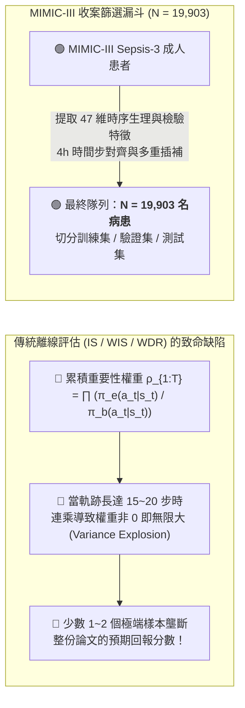

#### Slide 20｜[P06-2/3] DIRL 交互式時間摺積與 MT-Dueling DDQN ($V_1 + V_2$) 架構圖
- **核心創新：把狀態價值拆成「病患自身基線 $V_1(s)$」與「治療干預敏感度 $V_2(s)$」**：
  $$Q(s,a) = V_1(s) + V_2(s) + \left(A(s,a) - \frac{1}{|\mathcal{A}|}\sum_{a'} A(s,a')\right)$$
- **單頁核心 Graph（DIRL 雙分支時序提取 $\to$ MT-Dueling 三頭輸出閉環 DAG）**：
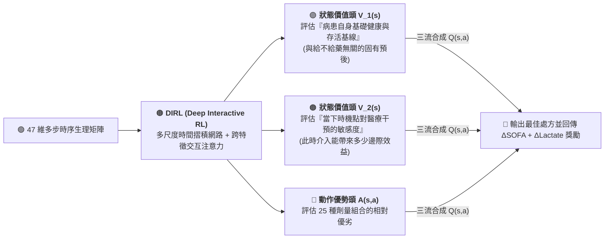

#### Slide 21｜[P06-3/3] DWDR 雙重退化權重公式流程圖與四種 OPE 指標完整對照表
- **關鍵實驗數據表（4 種 OPE 指標 × 不同策略完整比較）**：
  - 對比 `IS`、`WIS`、`WDR` 與本研究提出的 **`DWDR (Diminished Weighted Doubly Robust)`**：
  - 在 `MT-Dueling DDQN + DIRL` 架構下，**DWDR 達到最高預期價值 $11.5318$**，同時標準差與變異數較傳統 WDR 大幅收斂。
- **單頁核心 Graph（DWDR 如何用「退化單步根號權重」消除連乘爆炸 DAG）**：
```mermaid
flowchart LR
    Trad["🔴 <b>傳統 WDR 權重</b><br/>ρ_{1:t} = ρ_1 × ρ_2 × ... × ρ_t<br/><i>(隨步數 t 指數級爆炸或歸零)</i>"] ==>|"Yu 2023 數學改良"| Decay["🟢 <b>第一步：無記憶退化替換</b><br/>捨棄歷史連乘，僅保留當下單步權重<br/>並開平方根壓縮極端比值：<br/><b>ρ̃_t = √(π_e(a_t|s_t) / π_b(a_t|s_t))</b>"]
    Decay ==> Norm["🔵 <b>第二步：跨病患雙重穩健加權 (DWDR)</b><br/>結合 Q̂(s,a) 模型估計與歸一化退化權重 w̃_t<br/><b>徹底消除長軌跡變異數爆炸，穩定評估策略價值</b>"]
```
- **🐕 汪博士方法學批判 ＆ 🎓 LLM 教學提醒**：
  - **方法學批判**：DWDR 將連乘權重 $\rho_{1:t}$ 強行替換為單步開根號 $\sqrt{\rho_t}$，雖然大幅降低了變異數（Variance），但從嚴格的馬可夫反事實推論角度來看，它犧牲了「無偏性（Unbiasedness）」，屬於**以可控偏誤換取低變異數（Bias-Variance Tradeoff）**的近似指標。
  - **LLM 教學守則**：讓學生要求 LLM 推導為什麼「拿掉歷史連乘權重 $\rho_{1:t-1}$」會引入統計偏誤，不能無條件當作完美無偏估計量。

---

### 🔹 Paper 07｜Lin et al. (Digital Health 2023) — *A Dosing Strategy Model of DDPG Algorithm for Sepsis Patients*

#### Slide 22｜[P07-1/3] $5 \times 5$ 離散動作邊界跳躍失真痛點與 $N=13,930$ 收案篩選圖
- **🧭 頂部知識圖譜定位**：`[P01–P06 (皆受限於 5×5 離散劑量分箱)] ──(引入 DDPG Actor-Critic 連續劑量微調)──▶ ★【P07 Lin DH 2023】`
- **單頁核心 Graph（離散分箱失真痛點 ＋ $N=13,930$ 收案篩選漏斗 DAG）**：
```mermaid
flowchart LR
    subgraph BoxPain["5×5 離散劑量分箱的兩大臨床失真"]
        P_A["🔴 邊界偽跳躍：0.07 與 0.09 mcg/kg/min 僅差一點<br/>卻被切進不同等級 (Level 1 vs. Level 2)"]
        P_B["🔴 區間內粗糙化：同一等級內跨度極大<br/>無法給出床邊幫浦可直接設定的精確連續流速"]
    end

    subgraph Cohort7["MIMIC-III 連續動作隊列篩選漏斗 (N = 13,930)"]
        L1["🟢 MIMIC-III 成人敗血症患者"] -->|"提取 46 維生理與檢驗特徵<br/>保留真實連續輸液量與升壓藥劑量數值"| L2["🟢 最終隊列：<b>N = 13,930 名病患</b>"]
        L2 --> L_Tr["🟠 訓練集：80% (11,144 人)"]
        L2 --> L_Te["🔵 測試集：20% (2,786 人)"]
    end
```

#### Slide 23｜[P07-2/3] DDPG Actor-Critic 連續劑量微調與 Ornstein-Uhlenbeck 探索閉環圖
- **MDP 連續控制設計**：
  - $\mathcal{S}$：46 維連續生理特徵。
  - $\mathcal{A}$：二維連續動作向量 $a_t = (a_t^{\text{fluid}}, a_t^{\text{vaso}}) \in \mathbb{R}^2_+$。
  - 探索機制：加入具時間相關慣性的 **Ornstein-Uhlenbeck (OU) 隨機過程雜訊** $\mathcal{N}_t$，模擬臨床劑量平滑調整。
- **單頁核心 Graph（Actor-Critic 四網路協同與軟更新閉環 DAG）**：
```mermaid
flowchart LR
    S46["🟢 46 維連續狀態 s_t"] --> Actor["🟠 <b>Actor 策略網路 μ(s | θ^μ)</b><br/>直接輸出精確連續劑量座標 (Fluid, Vaso)"]
    Actor -->|"加上 OU 時間慣性探索雜訊 N_t"| ActCont["🔵 連續處方動作 a_t ∈ R^2"]
    S46 & ActCont --> Critic["🟠 <b>Critic 價值網路 Q(s, a | θ^Q)</b><br/>評估該連續劑量座標之預期存活回報"]
    Critic -.->|"計算動作梯度 ∇_a Q(s,a)<br/>指導 Actor 往高價值劑量微調"| Actor
    Actor & Critic -.->|"軟更新 Target Networks<br/>θ' ← τθ + (1-τ)θ' (τ=0.001)"| Targ["🟣 穩定訓練目標 y_t = r_t + γ Q'(s', μ'(s'))"]
```

#### Slide 24｜[P07-3/3] 低/中/高 SOFA 連續劑量分佈表與「環境模擬器自評偏差」因果圖
- **關鍵實驗數據表（依 SOFA 嚴重度分層之劑量與預估死亡率）**：
  - **低 SOFA 群**：AI 與醫師處方接近，維持低劑量。
  - **高 SOFA 重症群**：預估死亡率由臨床醫師基準之 **$52.5\%$** 大幅下降至 DDPG 策略之 **$29.6\%$**（在環境模擬器評估下）。
- **單頁核心 Graph（以神經網路模擬器評估連續 RL 的「裁判兼球員」自評陷阱 DAG）**：
```mermaid
flowchart TD
    Prob["🟢 為什麼連續動作 DDPG 很難用傳統 WIS/WDR 評估？<br/>因為連續空間中 P(a_AI == a_Physician) 幾乎為 0！"] --> Sim["🟠 作者解法：用 MIMIC-III 歷史資料<br/>訓練一個『環境狀態轉移與死亡率模擬器 (Simulator)』"]
    Sim --> Loop["🔴 <b>致命方法學陷阱：Model Exploitation (討好模擬器)</b><br/>DDPG 策略在訓練與評估時，學會利用模擬器在邊界區域的估計漏洞"]
    Loop ==> Inflation["🔴 模擬器預測高 SOFA 死亡率從 52.5% 降到 29.6%<br/><b>但這是『模型自己考自己』的樂觀偏誤，非真實臨床實證！</b>"]
```
- **🐕 汪博士方法學批判 ＆ 🎓 LLM 教學提醒**：
  - **方法學批判**：連續動作空間一旦失去傳統重要性抽樣（IS）的支援，改用學出來的轉移模型（Learned World Model / Classifier）打分數，極易發生「策略鑽模擬器漏洞」的虛假高分。
  - **LLM 教學守則**：教導學生看到「連續動作 RL 在醫療取得驚人死亡率下降」時，第一時間要問 LLM：「*這篇論文是用什麼評估器（Evaluator）算出死亡率下降的？是用真實反事實權重，還是用另一個神經網路分類器預測的？*」

---

### 🔹 Paper 08｜Wu et al. (Computer Methods and Programs in Biomedicine 2023) — *Value-Based DRL with Human Expertise (WD3QNE)*

#### Slide 25｜[P08-1/3] 純數據驅動違反臨床指引風險與 $N=20,943$ 收案篩選圖
- **🧭 頂部知識圖譜定位**：`[P03 Komorowski / P01 Raghu (純數據驅動可能違反臨床常規)] ──(嵌入三大人類專家硬性生理護欄 + 雙重優先回放)──▶ ★【P08 Wu CMPB 2023】 ──(引出 OPE 自評虛高與輕症稀釋反思)──▶ [P09 Choi 2024]`
- **單頁核心 Graph（純數據驅動違規風險 ＋ $N=20,943$ 收案漏斗 DAG）**：
```mermaid
flowchart LR
    subgraph GuidePain["純數據驅動 RL 的臨床合規危機"]
        G1["🔴 血壓已經正常 (MAP > 65 mmHg)<br/>純 RL 仍可能建議給予高劑量升壓藥"]
        G2["🔴 器官功能已恢復 (SOFA ≤ 3)<br/>純 RL 仍可能建議持續大量輸液造成肺水腫"]
    end

    subgraph Cohort8["MIMIC-III 收案與切分漏斗 (N = 20,943)"]
        W1["🟢 MIMIC-III Sepsis-3 成人患者<br/><b>N = 20,943 名病患</b> (45 維特徵)"] --> W_Tr["🟢 訓練集：80% (16,754 人)"]
        W1 --> W_Va["🟠 驗證集：10% (2,094 人)"]
        W1 --> W_Te["🔵 測試集：10% (2,095 人)"]
    end
```

#### Slide 26｜[P08-2/3] WD3QNE 雙重優先經驗回放與三大臨床專家生理護欄架構圖
- **三大臨床專家知識嵌入機制（Human Expertise Integration）**：
  1. **雙重優先經驗回放（Dual Prioritized Experience Replay）**：同時依據 `TD-error` 與 `病患最終存活結果` 調整抽樣優先權。
  2. **獎勵函數加入「偏離醫師處方懲罰項」**：當 AI 建議等級與醫師實際等級差距過大時給予負向懲罰。
  3. **硬性臨床安全防護罩（Hard Safety Shields）**：
     - 若病程末期 $\text{SOFA} \le 3$ $\implies$ 強制將輸液劑量清零（防止液體過載）。
     - 若 $\text{MAP} > 65\text{ mmHg}$ $\implies$ 強制將升壓藥劑量清零（符合 SSC 拯救敗血症指引）。
- **單頁核心 Graph（WD3QNE 訓練與臨床硬性防護罩攔截閉環 DAG）**：
```mermaid
flowchart LR
    Buf["🟢 雙重優先經驗回放池<br/>(TD-error + 生死結果加權)"] --> Net["🟠 <b>WD3QNE 深度網路</b><br/>輸出初始建議動作 a_raw"]
    Net --> R_Pen["🟣 <b>專家護欄 1 (軟約束)：行為偏離懲罰</b><br/>R_total = R_physio - λ · |a_AI - a_Doctor|"]
    Net ==> Shield1["🔴 <b>專家護欄 2 (硬攔截)：MAP > 65 mmHg？</b><br/>若是 ➔ 強制將升壓藥劑量設為 0"]
    Shield1 ==> Shield2["🔴 <b>專家護欄 3 (硬攔截)：末期 SOFA ≤ 3？</b><br/>若是 ➔ 強制將輸液劑量設為 0"]
    Shield2 ==> FinalA["🔵 最終合規安全處方 a_safe"]
```

#### Slide 27｜[P08-3/3] 預估存活率 $97.81\%$ 數據表與「行為懲罰導致 OPE 自評虛高」因果圖
- **關鍵實驗數據表（Ablation 漸進實驗）**：
  - 臨床醫師基準存活率：$86.52\%$
  - 標準 `D3QN` 預估存活率：$92.04\%$
  - `D3QN + 行為偏離懲罰獎勵`：$96.15\%$
  - 完整 `WD3QNE (含三大人類專家機制)`：**$97.81\%$**
- **單頁核心 Graph（為什麼預估存活率高達 $97.81\%$？揭開 OPE 自評膨脹的數學真相 DAG）**：
```mermaid
flowchart TD
    Pen["🟣 在獎勵函數中加入『偏離醫師處方懲罰』<br/>且在 MAP > 65 / SOFA ≤ 3 時強制清零"] --> SimDoc["🟠 結果：WD3QNE 學到的策略 π_e<br/>在輕中症存活病患身上與醫師策略 π_b 高度重合！"]
    SimDoc --> Weight["🔴 在計算 WIS / OPE 重要性權重 ρ = π_e / π_b 時：<br/><b>存活輕症病患的權重被完美保留，而少數重症死亡病患因處方差異大被權重歸零 (Weight Clipping/Zeroing)！</b>"]
    Weight ==> Fake97["🔴 <b>產生『預估存活率 97.81%』的統計海市蜃樓！</b><br/>(並非 AI 治癒了 97.8% 的敗血症，而是評估公式過濾掉了死亡重症軌跡)"]
```
- **🐕 汪博士方法學批判 ＆ 🎓 LLM 教學提醒**：
  - **方法學批判**：這是全簡報最精采的教學案例！臨床上敗血症不可能有 $97.81\%$ 的存活率。當你限制 AI 不准偏離醫師（或在穩定時強制歸零），OPE 就會把分數全部集中在原本就會活下來的輕症病人身上。
  - **LLM 教學守則**：如果直接把這篇論文餵給一般 LLM，LLM 只會照抄摘要說「*WD3QNE 將敗血症存活率提升至 97.81%，效果卓越*」。必須訓練學生識破這種**「獎勵約束與 OPE 權重耦合造成的指標膨脹」**！

---

### 🔹 Paper 09｜Choi et al. (Artificial Intelligence in Medicine 2024) — *HIGHLIGHT: DDDQN for Moderate-to-Severe Sepsis*

#### Slide 28｜[P09-1/3] 中重度休克同質化治療盲點與 HIGHLIGHT 雙隊列 79 特徵篩選圖
- **🧭 頂部知識圖譜定位**：`[P01–P08 (混入大量輕症患者稀釋風險 + 忽略 DNR 醫囑)] ──(聚焦中重度休克 + 79 特徵 + Shapley 解釋 + 揭露 DNR 陷阱)──▶ ★【P09 Choi Artif Intell Med 2024】`
- **單頁核心 Graph（輕症稀釋盲點 ＋ 中重度休克雙隊列嚴格篩選漏斗 DAG）**：
```mermaid
flowchart LR
    subgraph MildBias["前人研究 (P01–P08) 的收案盲點"]
        M_A["🔴 Sepsis-3 (SOFA ≥ 2) 包含大量<br/>不需升壓藥、血乳酸正常的輕症患者"]
        M_B["🔴 模型學會『不給藥 (0,0)』就能在輕症拿到高存活率<br/>卻在真正休克重症患者身上失靈！"]
        M_A --> M_B
    end

    subgraph HighlightFunnel["HIGHLIGHT 聚焦中重度休克雙隊列篩選漏斗 (79 維特徵)"]
        H1["🟢 嚴格納入條件：敗血症合併<br/><b>血乳酸 Lactate > 2 mmol/L 或需升壓藥維持 MAP ≥ 65</b><br/>且伴隨中重度器官功能障礙"]
        H1 --> HM["🟢 <b>MIMIC-III 重症隊列：N = 4,124</b><br/>(基準死亡率高達 28.5%)"]
        H1 --> HE["🔵 <b>eICU 跨院重症隊列：N = 3,815</b><br/>(基準死亡率高達 24.1%)"]
    end
```

#### Slide 29｜[P09-2/3] 雙通道臨床安全懲罰獎勵函數與 Deep Shapley 特徵歸因架構圖
- **MDP 關鍵設計**：
  - $\mathcal{S}$：擴充至 **79 維臨床特徵**（包含完整生命徵象、血氣分析、凝血功能、累積液體平衡與過往處方趨勢）。
  - $R$：除了終端生死與 $\Delta\text{SOFA}$、$\Delta\text{Lactate}$ 外，明確加入**「液體過載懲罰（$\text{CVP} > 12\text{ mmHg}$ 或體重增加 $>5\%$）」**與**「升壓藥過量懲罰（$\text{MAP} > 85\text{ mmHg}$ 仍給高劑量升壓藥）」**。
- **單頁核心 Graph（79 特徵 DDDQN ＋ 雙向生理過載懲罰 ＋ Deep SHAP 可解釋歸因閉環 DAG）**：
```mermaid
flowchart LR
    S79["🟢 79 維高密度臨床特徵 s_t"] --> DDDQN["🟠 <b>HIGHLIGHT (Dueling Double DQN)</b><br/>針對中重度休克學習 5×5 精準處方"]
    DDDQN --> Pen1["🟣 <b>安全懲罰通道 1：防範液體過載</b><br/>若 CVP > 12 mmHg 或體重增 > 5%<br/>仍給高輸液 ➔ 給予負向獎勵懲罰"]
    DDDQN --> Pen2["🟣 <b>安全懲罰通道 2：防範過度升壓</b><br/>若 MAP > 85 mmHg 仍給高升壓藥<br/>➔ 給予血管過度收縮懲罰"]
    DDDQN ==> SHAP["🔵 <b>Deep SHAP (Shapley Additive Explanations)</b><br/>量化每一項生理特徵對單筆處方 Q 值的正負貢獻度"]
```

#### Slide 30｜[P09-3/3] 跨院外部驗證數據與「DNR 放棄急救醫囑反向因果陷阱」圖解
- **關鍵實驗數據表（中重度休克跨院驗證）**：
  - **MIMIC-III 重症隊列（$N=4,124$）**：實際死亡率 $28.5\%$ $\to$ HIGHLIGHT 策略預估死亡率 **$14.2\%$**。
  - **eICU 外部驗證隊列（$N=3,815$）**：實際死亡率 $24.1\%$ $\to$ HIGHLIGHT 策略預估死亡率 **$16.8\%$**。
- **單頁核心 Graph（DNR 放棄急救／撤除維生治療造成的「反向因果陷阱」DAG）**：
```mermaid
flowchart TD
    Term["🔴 <b>病患進入不可逆臨終狀態 (Terminal Multi-Organ Failure)</b>"] ==>|"家屬與醫療團隊簽署<br/>DNR / 撤除維生治療 (Comfort Care)"| Withdraw["🔴 <b>臨床醫師主動調降或停止升壓藥與輸液<br/>(Action 變為 0,0)</b>"]
    Term ==>|"病程自然終點"| Die["🔴 <b>病患隨後死亡 (Reward = -15)</b>"]
    Withdraw -.->|"✖ 反向因果幻覺 (Reverse Causality)！<br/>在純數據表中看似『停止給藥 ➔ 導致死亡』"| AI_Mislead["🟠 <b>未記錄 DNR 標籤的 RL 模型被嚴重誤導</b>：<br/>誤以為『只要不減藥、繼續狂催升壓藥就能救活臨終病人』"]
```
- **🐕 汪博士方法學批判 ＆ 🎓 LLM 教學提醒**：
  - **方法學批判**：Choi et al. (2024) 特別點出 EHR 電子病歷中常缺乏明確時間戳記的 **DNR（Do-Not-Resuscitate）與撤除維生醫療（Withdrawal of Life-Sustaining Therapy）** 紀錄。因為病人快過世才停藥，卻被無因果意識的 RL 當成「停藥害死病人」。
  - **LLM 教學守則**：這是醫療 AI 最經典的**反向因果（Reverse Causality / Confounding by End-of-Life Care）**教材！務必讓學生學會檢查訓練資料是否排除了 Comfort Care / DNR 階段的軌跡。

---

## 🏆 三、【Module C】跨篇知識圖譜綜合收斂與互動檢測（Slides 31–34，共 4 頁）

### Slide 31｜【全景對照表】9 篇敗血症 RL 論文「狀態 × 動作 × 獎勵 × OPE × 臨床限制」總矩陣
- **內容設計**：以一張高資訊密度、色彩編碼對齊的日式表格，橫向總結 P01–P09 的：
  1. 年份與期刊、2. 訓練/驗證隊列與樣本數 $N$、3. 狀態表徵維度與編碼器、4. 動作空間、5. 獎勵函數核心項、6. RL 演算法、7. OPE 評估指標與關鍵數據、8. 汪博士點出的核心方法學限制。

---

### Slide 32｜【方法學核心總結】敗血症離線 RL 四大因果與評估陷阱總網路圖（SCM）
- **單頁核心 Graph（整合全簡報 9 篇論文教訓的結構因果模型 Structural Causal Model DAG）**：
```mermaid
flowchart TB
    subgraph Confounders["🔴 未觀測／未妥善控制的臨床混淆因子 (Unobserved Confounders)"]
        U1["潛在休克嚴重度與共病基線<br/>(Unobserved Severity)"]
        U2["DNR 放棄急救與撤除維生醫囑<br/>(End-of-Life Withdrawal)"]
    end

    subgraph Observed["🟢 電子病歷 (EHR) 可觀測軌跡"]
        S_obs["觀測生理狀態 s_t<br/>(MAP, Lactate, SOFA, BUN)"]
        A_doc["醫師實際處方 a_t<br/>(輸液與升壓藥劑量)"]
        Y_out["最終存活或死亡結果 Y"]
    end

    subgraph Traps["🟠 離線 RL 訓練與評估的四大失真陷阱"]
        Trap1["<b>陷阱 1：U 型曲線適應症混淆</b><br/>瀕死病患接受極端搶救劑量而死<br/>被誤認為『偏離 AI 導致死亡』 (P01, P03)"]
        Trap2["<b>陷阱 2：全零動作 (0,0) 獎勵駭客</b><br/>給藥常伴隨短期指標惡化<br/>AI 學會不給藥以規避 ΔSOFA 懲罰 (P02)"]
        Trap3["<b>陷阱 3：DNR 反向因果誤導</b><br/>臨終撤除升壓藥後死亡<br/>AI 誤以為『停藥導致死亡』 (P09)"]
        Trap4["<b>陷阱 4：OPE 權重爆炸與自評虛高</b><br/>連乘權重崩潰或懲罰偏離醫師<br/>製造 97.81% 存活率海市蜃樓 (P06, P07, P08)"]
    end

    U1 ==> S_obs & A_doc & Y_out
    U2 ==> A_doc & Y_out
    S_obs --> A_doc --> Y_out
    U1 -.-> Trap1
    S_obs & A_doc -.-> Trap2
    U2 -.-> Trap3
    A_doc & Y_out -.-> Trap4
```

---

### Slide 33｜【未來研究藍圖】從 9 篇文獻缺口推導出的 4 大新研究方向 ＆ LLM Wiki 協作流
- **單頁核心 Graph（現有缺口 $\to$ 4 大未來突破點 ＋ Karpathy LLM Wiki 知識複利閉環圖）**：
```mermaid
flowchart LR
    subgraph Gaps["現有 9 篇文獻的 4 大研究缺口"]
        G_1["缺口 1：固定 4h 時間步<br/>無法反映急診/ICU 每 15–30 分鐘的升壓滴定"]
        G_2["缺口 2：缺乏顯式因果反事實推論<br/>(Causal Inference + Offline RL)"]
        G_3["缺口 3：僅用結構化數值<br/>忽略護理紀錄、超音波與臨床筆記 (Multi-modal)"]
        G_4["缺口 4：離線 OPE 與床邊隨機臨床試驗 (RCT)<br/>之間缺乏前瞻性影子模式 (Shadow Mode) 驗證"]
    end

    subgraph WikiLoop["🐕 Karpathy LLM Wiki 知識庫複利閉環"]
        W_Raw["1. Raw Sources<br/>放入原始 PDF 論文"] --> W_Ingest["2. Ingest & Extract<br/>汪博士萃取 MDP、數據與因果圖"]
        W_Ingest --> W_Link["3. Cross-Link Wiki<br/>更新跨篇比較矩陣與概念頁"]
        W_Link --> W_Out["4. Compounding Outputs<br/>產出 Graph 投影片與新研究假說"]
        W_Out -.->|"發現新問題"| W_Raw
    end

    Gaps ==> WikiLoop
```

---

### Slide 34｜【汪博士隨堂互動測驗】4 道臨床 AI 與 LLM 讀論文盲點翻卡挑戰
- **互動設計**：4 張日式和紙問答卡，點擊即可翻開顯示「汪博士正解與對應論文頁碼跳轉鈕」：
  - **Q1（對應 P01/P03）**：為什麼所有敗血症 RL 論文畫出的「劑量差異 vs. 死亡率 U 型曲線」，不能直接當作 AI 比醫師高明的因果鐵證？
  - **Q2（對應 P02/P09）**：為什麼一個在離線評估分數很高的 RL 模型，面對中重度敗血症休克患者時，竟然可能頻繁建議 `Action (0,0)`（完全不輸液也不給升壓藥）？
  - **Q3（對應 P06/P08）**：某篇論文宣稱其 RL 模型在 MIMIC-III 測試集上的預估存活率高達 $97.81\%$，請問這個數字背後最可能隱藏了什麼評估公式陷阱？
  - **Q4（對應 P09）**：如果不把簽署 `DNR（放棄急救／撤除維生治療）` 的臨終病患階段標註或排除，會對強化學習模型造成什麼樣的反向因果誤導？

---

## 🔍 檢查點 Gate 2 & Gate 3：確認後即進入 Stage 4（一次性生成最終 HTML 投影片）

請檢閱上方 34 頁的 **逐頁 Graph 節點與連線藍圖** 與 **日式清新視覺語意規範**。若您確認內容與結構無誤（或有任何想微調的節點／數據），請點擊確認或告訴我修改意見，汪博士就會立即執行 **Stage 4：將這份 34 頁 Graph 藍圖完整編譯為包含「可點擊互動知識圖譜導覽」與「SVG/結構化有向圖」的日式清新 HTML 投影片**！
