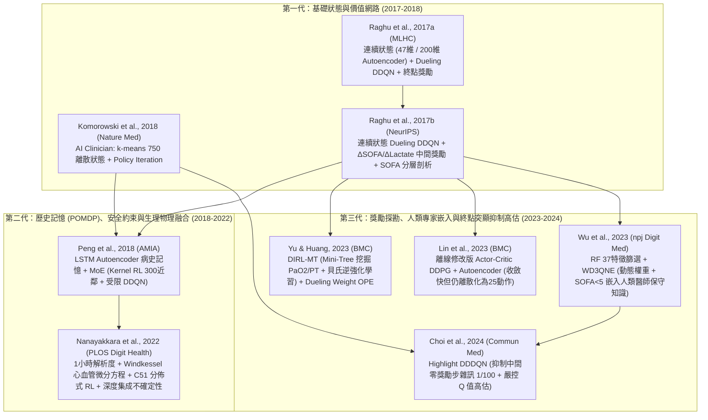

# 強化學習於敗血症輸液與升壓藥決策之演進 (RL for Sepsis Fluid & Vasopressor Dosing)

> **🐾 汪博士主題總覽**：
> 
> 自 2017 年起，如何利用加護病房電子病歷 (MIMIC-III, eICU) 透過**離線強化學習 (Offline Reinforcement Learning)** 尋找敗血症最佳「靜脈輸液 (IV Fluids) + 升壓藥 (Vasopressors)」劑量組合，成為醫療 AI 領域最熱門也最具爭議的聖杯任務。本專頁綜整知識庫已收錄之 **9 篇代表性論文（2017–2024）**，完整梳理其狀態表徵、演算法架構、獎勵設計與離線評估 (OPE) 的演進脈絡。

---

## 1. 演算法與狀態表徵演進圖譜 (2017–2024)

---

## 2. 九篇敗血症 RL 論文之 MDP 五要素橫向比較矩陣

| 論文 Citation | 狀態空間表徵 $\mathcal{S}$ (State Space) | 時間步 $\Delta t$ | 動作空間 $\mathcal{A}$ (Action Space) | 獎勵函數設計 $\mathcal{R}$ (Reward Function) | 核心 RL 演算法 |
| :--- | :--- | :---: | :---: | :--- | :--- |
| **[Raghu et al., 2017a](../papers/2017-raghu-continuous-state-drl-mlhc.md)** | 47 維連續特徵 / **200 維 Sparse Autoencoder** | 4h | $5 \times 5 = 25$ (IV + Max VP) | **純終點獎勵**：院內存活 $+15$，死亡 $-15$（中間 $0$） | Dueling DDQN (PER, Q-clip $\pm 15$) |
| **[Raghu et al., 2017b](../papers/2017-raghu-shaped-reward-drl-nips.md)** | 48 維連續特徵（含 Timestep） | 4h | $5 \times 5 = 25$ | **臨床形塑中間獎勵**：$\Delta\text{SOFA} + \tanh(\Delta\text{Lactate})$，終點 $\pm 15$ | Dueling DDQN ($Q_{\text{thresh}} = \pm 20$) |
| **[Komorowski et al., 2018](../papers/2018-komorowski-ai-clinician.md)** | 48 維特徵經 **`k-means++` 聚類為 750 個離散狀態** | 4h | $5 \times 5 = 25$（限制出現 $\ge 5$ 次動作） | **純終點獎勵**：90天/院內存活 $+100$，死亡 $-100$ ($\gamma=0.99$) | Tabular MDP Policy Iteration (500 模型選優) |
| **[Peng et al., 2018](../papers/2018-peng-moe-kernel-drl.md)** | 50 維特徵經 **128 維 LSTM Autoencoder** 編碼完整歷史 | 4h | $5 \times 5 = 25$（DQN 限制 300 近鄰中醫師使用 $\ge 1\%$ 動作） | **預估死亡率對數勝算比負變化**：$-\Delta \text{log-odds}(f(o)) \in [-3, 3]$ | **Mixture-of-Experts (MoE)**：Kernel RL + 受限 Dueling DDQN |
| **[Nanayakkara et al., 2022](../papers/2022-nanayakkara-cardiovascular-uncertainty-drl.md)** | **Windkessel 心血管物理方程 ($R, C, SV, T$) + Denoising GRU** | **1h** | **$3 \times 3 = 9$**（配合 1h 解析度縮減） | 純終點獎勵（存活 vs. 死亡） | **Categorical Distributional RL (C51)** + 25 Ensembles + Behavior Cloner |
| **[Yu & Huang, 2023](../papers/2023-yu-dirl-mt-dueling-weight-ope.md)** | 30 維特徵（ETR 插補至 1h） | **1h** | $5 \times 5 = 25$ | **逆強化學習自動加權**：`MAP` + `Lactate` + **`PaO2` + `PT`** | **DIRL-MT** (Mini-Tree + Bayesian IRL + DDDQN) |
| **[Lin et al., 2023](../papers/2023-lin-ddpg-dosing-strategy.md)** | 48 維特徵 $\to$ **200 維 Autoencoder** | 4h | $5 \times 5 = 25$（輸出仍離散化） | 同 Raghu 2017b（$\Delta\text{SOFA} + \tanh(\Delta\text{Lactate})$，終點 $\pm 15$） | 離線修改版 **DDPG** (Actor-Critic + 獎勵加權抽樣) |
| **[Wu et al., 2023](../papers/2023-wu-wd3qne-human-expertise.md)** | Random Forest OOB 篩選之 **37 維核心特徵** | 4h (MIMIC) 1h (eRI) | $5 \times 5 = 25$ | 中間獎勵 $0.6(\text{SOFA}_t - \text{SOFA}_{t+1})$，終點 $\pm 24$ | **WD3QNE**（動態加權 D3QN + $\text{SOFA}<5$ 嵌入人類醫師價值） |
| **[Choi et al., 2024](../papers/2024-choi-highlight-dddqn.md)** | 47 維連續特徵（Z-score 截斷 $[-3.3, 3.3]$） | 4h | $5 \times 5 = 25$ | **純終點獎勵**：90天/院內存活 $+1$，死亡 $-1$（中間 $0$） | **Highlight DDDQN**（中間步損失縮小 $1/100$ + 高估早停監控） |

---

## 3. 四大核心方法學爭論與演進洞察

### 3.1 離散狀態聚類 (Clustering) vs. 連續/循環狀態表徵 (Continuous & Recurrent States)
- **離散聚類 ([Komorowski et al., 2018](../papers/2018-komorowski-ai-clinician.md))**：優點是能直接算轉移矩陣並用 Policy Iteration 得到全域精確解；缺點是 750 個聚類中心抹平了細微生理差異，且聚類邊界兩側病患處方可能劇烈跳動。
- **前饋連續狀態 ([Raghu 2017a](../papers/2017-raghu-continuous-state-drl-mlhc.md), [Wu 2023](../papers/2023-wu-wd3qne-human-expertise.md), [Choi 2024](../papers/2024-choi-highlight-dddqn.md))**：保留完整連續數值，但單一 4 小時快照違反馬可夫假設。
- **循環記憶與物理約束狀態 ([Peng 2018](../papers/2018-peng-moe-kernel-drl.md), [Nanayakkara 2022](../papers/2022-nanayakkara-cardiovascular-uncertainty-drl.md))**：透過 LSTM/GRU 捕捉完整病史軌跡，甚至將 Windkessel 心血管定律寫入潛在空間，是處理重症 POMDP 最具解釋性的方向。

### 3.2 獎勵函數兩難：純終點生死獎勵 vs. 人工中間生理獎勵
- **純終點獎勵派 ([Raghu 2017a](../papers/2017-raghu-continuous-state-drl-mlhc.md), [Komorowski 2018](../papers/2018-komorowski-ai-clinician.md), [Choi 2024](../papers/2024-choi-highlight-dddqn.md))**：
  - 認為人工中間獎勵會引入人類偏見（例如為了降短期 SOFA 而過度升壓損害長期存活）。
  - [Choi et al., 2024](../papers/2024-choi-highlight-dddqn.md) 證明只要把中間步 ($r=0$) 的更新權重除以 $h=100$（Highlight DDDQN），就能在不加任何人工獎勵下穩定學出高存活率策略。
- **中間生理獎勵派 ([Raghu 2017b](../papers/2017-raghu-shaped-reward-drl-nips.md), [Peng 2018](../papers/2018-peng-moe-kernel-drl.md), [Yu 2023](../papers/2023-yu-dirl-mt-dueling-weight-ope.md), [Wu 2023](../papers/2023-wu-wd3qne-human-expertise.md))**：
  - 認為 72 小時後才給一次生死訊號太過稀疏，加入 $\Delta\text{SOFA}$、$\Delta\text{Lactate}$ 或逆強化學習挖掘之 `PaO2`/`PT` 能提供密集的生理引導。

### 3.3 抑制離線強化學習「分布外動作高估 (OOD Action Overestimation)」的四大流派
在離線歷史病歷中，純 DQN 極易對罕見或極端動作（如最高劑量輸液+升壓藥）產生虛高 Q 值（[Peng et al., 2018](../papers/2018-peng-moe-kernel-drl.md) 證實未受限 DQN 開立最大劑量的頻率是醫師的 **3.8 倍**）。這 9 篇論文發展出四種安全機制：
1. **狀態-動作頻率硬門檻**：[Komorowski 2018](../papers/2018-komorowski-ai-clinician.md) 限制只選出現 $\ge 5$ 次的動作；[Peng 2018](../papers/2018-peng-moe-kernel-drl.md) 限制只選 300 個近鄰中醫師開立率 $\ge 1\%$ 的動作並結合 Kernel RL。
2. **認知不確定性懲罰與行為複製混合**：[Nanayakkara 2022](../papers/2022-nanayakkara-cardiovascular-uncertainty-drl.md) 以 25 個深度集成的 KL Divergence 懲罰高不確定性動作，並與 Behavior Cloner 線性混合。
3. **按嚴重度嵌入人類專家規則**：[Wu 2023](../papers/2023-wu-wd3qne-human-expertise.md) 在輕症 ($\text{SOFA} < 5$) 強制切換回人類醫師價值函數，避免輕症濫用升壓藥。
4. **訓練期 Q 值邊界監控與早停**：[Choi 2024](../papers/2024-choi-highlight-dddqn.md) 嚴格監控預估價值是否超出 $[-1, 1]$ 理論上界，在高估發生前停止訓練。

### 3.4 離線策略評估 (Off-Policy Evaluation, OPE) 的演進與失真陷阱

| OPE 評估方法 | 使用代表論文 | 核心機制 | 汪博士方法學批判（為何容易失真？） |
| :--- | :--- | :--- | :--- |
| **WIS (Weighted Importance Sampling)** | [Komorowski 2018](../papers/2018-komorowski-ai-clinician.md) | 以目標策略與行為策略機率比連乘作為軌跡權重 | 當軌跡長達 18~72 步時，只要幾步與醫師不同權重即趨近 0，評估結果被少數高度吻合（通常較健康）的病患主導 |
| **DR / WDR (Doubly Robust / Weighted DR)** | [Raghu 2017a](../papers/2017-raghu-continuous-state-drl-mlhc.md), [Peng 2018](../papers/2018-peng-moe-kernel-drl.md), [Wu 2023](../papers/2023-wu-wd3qne-human-expertise.md) | 結合 IS 權重與預估價值模型 $\widehat{Q}$ | 對確定性策略而言 IS 權重多為 0，退化為由 AI 自己的 $\widehat{Q}$ 給自己打分數，導致 [Wu 2023](../papers/2023-wu-wd3qne-human-expertise.md) 映射出 **97.81% 存活率** 的不合理膨脹 |
| **DW / DWDR (Dueling Weight OPE)** | [Yu & Huang 2023](../papers/2023-yu-dirl-mt-dueling-weight-ope.md) | 以當前 $\widehat{Q}$ 與歷史平均 $\widehat{Q}_{\text{means}}$ 比值取代連乘權重 | 有效消除指數級變異數爆炸，但偏離無偏機率測度變換，依賴 $\widehat{Q}$ 準確性 |
| **劑量差距 U 型曲線 / 配對病患實際存活率** | [Raghu 2017a](../papers/2017-raghu-continuous-state-drl-mlhc.md), [Lin 2023](../papers/2023-lin-ddpg-dosing-strategy.md), [Choi 2024](../papers/2024-choi-highlight-dddqn.md) | 統計實際接受與 AI 相近劑量病患的真實存活率 | 雖為真實觀察存活率，但受 **依適應症混淆 (Confounding by Indication)** 與 **臨終撤除治療 (DNR)** 影響（[Nanayakkara 2022](../papers/2022-nanayakkara-cardiovascular-uncertainty-drl.md) 證實死前 10h 醫師停藥） |
