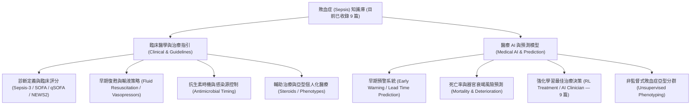

# 敗血症跨文獻證據大表與方法學陷阱對照矩陣

> [!NOTE] 🐾 汪博士放大鏡綜合評析
> 
> 
> 這張大表是我們撰寫論文 **Related Work / Discussion**、**Systematic Review** 與 **研究計畫書 (Grant / IRB)** 的核心武器！
> 每讀完一篇敗血症論文，我都會自動將它填入對應的「臨床指引/RCT 表」或「醫療 AI 模型表」，並用五大方法學照妖鏡幫你抓出各篇研究之間的矛盾與盲點！

---

## 1. 敗血症研究雙主軸分類樹 (Taxonomy Tree)

---

## 2. 【表 A-1】敗血症強化學習 (RL) 輸液與升壓藥決策模型跨文獻對照大表

> [!CAUTION] ⚠️ 最高醫療安全防線
> 下表所列 9 篇強化學習論文皆為 **`[Retrospective 回溯性建模]`**，其策略價值與估計存活率均來自離線策略評估 (OPE) 或歷史配對觀察，**尚未經前瞻性隨機對照試驗 (RCT) 驗證**。

| 文獻 Citation / 證據等級 | 收案場域 / 資料庫 ($N$, 基線死亡率) | 敗血症定義 & **$T_0$ / 時間步 $\Delta t$** | 狀態表徵 $\mathcal{S}$ / 動作 $\mathcal{A}$ / 演算法 | 獎勵函數 $\mathcal{R}$ | 評估方法 (OPE) 與核心量化結果 | 驗證等級 (TRIPOD+AI) | 🔍 五大方法學陷阱與臨床盲點審視 |
| :--- | :--- | :--- | :--- | :--- | :--- | :--- | :--- |
| **[Raghu et al., 2017a](../papers/2017-raghu-continuous-state-drl-mlhc.md)** `MLHC` `[Retrospective 回溯性建模]` | ICU / MIMIC-III v1.4 ($N = 17,898$, 院內死亡率 13.7%) | Sepsis-3 ($\text{SOFA} \ge 2$) $T_0$: 培養/抗生素較早者 $-24\text{h} \sim +48\text{h}$, $\Delta t = 4\text{h}$ | 47 維連續特徵或 **200 維 Sparse Autoencoder** $5 \times 5 = 25$ 動作 **Dueling DDQN** | 終點生死獎勵 $\pm 15$（中間 $0$） | **Doubly Robust OPE + U-curve**： • 醫師回報 $9.87$ (估計死亡率 $13.9\pm 0.5\%$) • Normal Q-N 回報 $10.16$ ($12.8\pm 0.5\%$) • **Autoencode Q-N 回報 $10.73$ (估計死亡率 $11.2\pm 0.4\%$，降 $1.8\sim 3.6\%$)** | Internal Split (MIMIC-III) | 1. U-curve 存在**依適應症混淆**（零差距多為不需用藥之輕症）。 2. 終點稀疏獎勵使輸液策略學習薄弱。 3. 忽略跨步歷史 (MDP 假設)。 |
| **[Raghu et al., 2017b](../papers/2017-raghu-shaped-reward-drl-nips.md)** `NeurIPS ML4H` `[Retrospective 回溯性建模]` | ICU / MIMIC-III v1.4 ($N = 17,898$, 院內死亡率 13.7%) | 同 Raghu 2017a 並分層為 Low ($<5$), Med ($5\sim 15$), High ($>15$) SOFA | 48 維連續特徵 $5 \times 5 = 25$ 動作 **Dueling DDQN** ($Q_{\text{clip}}=\pm 20$) | **臨床中間獎勵**： $\Delta\text{SOFA} + \tanh(\Delta\text{Lactate})$ 終點 $\pm 15$ | **按 SOFA 嚴重度分層 U-curve**： • Medium SOFA ($5\sim 15$) 維持典型 U 型曲線。 • **High SOFA ($>15$) U 型曲線完全崩潰！** | Internal Split (MIMIC-III) | 1. **陷阱五（次族群盲區）**：證實重度衰竭 ($\text{SOFA}>15$) 樣本稀疏導致 RL 失準。 2. 點出確定性策略使 IS 權重歸零、DR 退化。 |
| **[Komorowski et al., 2018](../papers/2018-komorowski-ai-clinician.md)** `Nature Medicine` `[Retrospective 回溯性建模]` | ICU / MIMIC-III ($N = 17,083$, 90d 死亡率 18.9%) **外部：Philips eRI** ($N = 79,073$, 128 院, 院內死亡率 16.4%) | Sepsis-3 MIMIC: $-24\text{h}\sim +48\text{h}$ eRI: 入院後 72h $\Delta t = 4\text{h}$；**排除疑似撤除治療 (DNR)** | 48 特徵經 **`k-means++` 聚類為 750 離散狀態** $5 \times 5 = 25$ 動作 ($\ge 5$ 次安全限制) **Policy Iteration** | 終點獎勵 $\pm 100$ ($\gamma=0.99$) | **HCOPE (WIS, 2000 bootstraps)**： • eRI 外部驗證 AI 中位價值 **$84.5$** (IQR $84.3\sim 87.7$) vs. 醫師 **$56.9$** ($54.7\sim 58.8$)。 • **策略轉變**：減少輸液、**升壓藥頻率由 17% 增至 30%**。 | **External Validation** (跨 128 家醫院 eRI) | 1. **Gottesman 2019 批判**：WIS 99% 貪婪策略使不吻合軌跡權重趨近 0，評估僅由少數吻合（較穩定）病患主導。 2. 750 離散聚類損失連續資訊。 3. eRI 因紀錄不全排除了 72% (331/459) ICU。 |
| **[Peng et al., 2018](../papers/2018-peng-moe-kernel-drl.md)** `AMIA` `[Retrospective 回溯性建模]` | ICU / MIMIC-III v1.4 ($N = 15,415$, 院內死亡率 12.2%) | Sepsis-3 72h, $\Delta t = 4\text{h}$ 排除含缺失值病患 | 50 特徵 $\to$ **128 維 LSTM Autoencoder** (POMDP) $5 \times 5 = 25$ 動作 **MoE (Kernel RL 300 近鄰 + 受限 DDQN)** | 預估死亡率對數勝算比負變化 $-\Delta\text{log-odds} \in [-3, 3]$ | **Weighted Doubly Robust (WDR)**： • 醫師 $3.76$ / 純 DQN $4.23$ / Kernel $4.46$ / **MoE $5.03$ ($V_d$) & $5.72$ ($V_b$)**。 • 純 DQN 開最高劑量頻率為醫師 **3.8 倍**；MoE 與 Kernel 相似度 $87.1\%$。 | Internal Split (MIMIC-III) | 1. 揭露純 DQN 嚴重之分布外動作高估。 2. 門控網路直接最大化 WDR 指標可能存在對評估器過擬合。 3. 剔除缺失值病患造成選擇偏差。 |
| **[Nanayakkara et al., 2022](../papers/2022-nanayakkara-cardiovascular-uncertainty-drl.md)** `PLOS Digit Health` `[Retrospective 回溯性建模]` | ICU / MIMIC-III v1.4 排除轉出 ICU 後於一般病房死亡者 | Sepsis-3 **$\Delta t = 1\text{h}$ (1 小時解析度)** | 41 特徵 $\to$ **Windkessel 心血管方程 ($R, C, SV, T$) + Denoising GRU** **$3 \times 3 = 9$ 動作** **C51 分佈式 RL + 25 Ensembles** | 終點生死獎勵 | **生理一致性與臨終軌跡剖析（拒絕報失真 OPE）**： • Top 特徵：`CNS`, `BUN`, `SOFA`, `HR`, `HB`, Windkessel `R` & `SV`。 • **發現死前 10h 醫師升壓藥由 55% 驟降至 <30% (DNR)，AI 卻達 75~80%**。 | Internal Split (MIMIC-III) | 1. **揭開最大臨床混淆**：證明死前 10 小時家屬/醫師撤除升壓藥 (DNR) 是造成回溯性 RL 與醫師分歧的主因。 2. 點出傳統 OPE 可被「不給藥策略」鑽漏洞。 |
| **[Yu & Huang, 2023](../papers/2023-yu-dirl-mt-dueling-weight-ope.md)** `BMC Med Inform` `[Retrospective 回溯性建模]` | ICU / MIMIC-III v1.4 ($N = 14,012$, 院內死亡率 14.5%) | Sepsis-3 72h, **$\Delta t = 1\text{h}$** (以 Extra Trees Regressor 插補) | 30 特徵 $5 \times 5 = 25$ 動作 **DIRL-MT (Mini-Tree + 貝氏逆強化學習 BIRL + DDDQN)** | 自動探勘組合： `MAP` + `Lactate` + **`PaO2` + `PT`** ($\text{Reward}_{3.0+ + 4.0}$) | **Dueling Weight (DW / DWDR) & DR OPE**： • 醫師 $V_{\text{DR}}=0.1659$ (死亡率 $14.5\pm 0.5\%$) • **DIRL-MT $V_{\text{DR}}=0.2307$ (估計死亡率 $11.3\pm 0.4\%$，降 3.2%)** • 減少 40% 輸液與 35% 升壓藥。 | Internal Split (MIMIC-III) | 1. 發現 `PaO2` 與 `PT` 能煞住過度輸液（防肺水腫與稀釋性凝血病變）。 2. **陷阱一疑慮**：使用 ETR 進行 1h 插補若非嚴格前向插補，恐有未來資訊洩漏。 |
| **[Lin et al., 2023](../papers/2023-lin-ddpg-dosing-strategy.md)** `BMC Med Inform` `[Retrospective 回溯性建模]` | ICU / MIMIC-III (篩選 38,600 成人住院, 基線死亡率 15.7%) | Sepsis-3 $-24\text{h} \sim +48\text{h}$, $\Delta t = 4\text{h}$ | 48 特徵 $\to$ **200 維 Autoencoder** $5 \times 5 = 25$ 離散動作 **離線修改版 DDPG (Actor-Critic)** | 同 Raghu 2017b ($\Delta\text{SOFA} + \tanh(\Delta\text{Lactate})$, 終點 $\pm 15$) | **收斂速度與零劑量差距區 (Brown Region) 死亡率**： • 收斂步數快 10 倍 (2,000 vs 20,000)。 • 與醫師一致樣本佔 **30.96%** (vs DQN 12.77%)，該區死亡率 **11.59%** (vs DQN 14.17%)。 | Internal Split (MIMIC-III) | 1. **方法學矛盾**：使用連續控制 DDPG 卻仍將輸出離散化為 25 格。 2. **嚴重依適應症混淆**：將「高度模仿醫師對輕症開 0 劑量」之低死亡率誤當成療效。 |
| **[Wu et al., 2023](../papers/2023-wu-wd3qne-human-expertise.md)** `npj Digital Medicine` `[Retrospective 回溯性建模]` | ICU / MIMIC-III ($N = 17,083$, 90d 存活率 81.1%) **外部：eRI 子集** ($N = 1,500$, 院內存活率 80.12%) | Sepsis-3 MIMIC: 80h, $\Delta t = 4\text{h}$ eRI: $\Delta t = 1\text{h}$ 排除撤除治療 | RF OOB 篩選 **37 特徵** (`BUN`, `Age` 居首) $5 \times 5 = 25$ 動作 **WD3QNE (動態權重 + $\text{SOFA}<5$ 人類專家嵌入)** | $0.6(\text{SOFA}_t - \text{SOFA}_{t+1})$ 終點 $\pm 24$ | **Doubly Robust OPE + 存活率映射曲線**： • MIMIC 預期回報 $23.63/24$，映射存活率 **97.81%** (vs 醫師 83.26%)。 • eRI 預期回報 $21.81$，映射存活率 **95.83%**。 • 顯著減少 $\text{SOFA}<5$ 升壓藥濫用。 | **External Validation** (eRI $N=1,500$) | 1. **OPE 外推嚴重膨脹**：回報 $23.63$ 逼近滿分 $+24$，映射出 **97.81% 存活率（死亡率僅 2.19%）**，違反重症醫學常理。 2. 證實 `BUN` 與 `Age` 為最重要特徵。 |
| **[Choi et al., 2024](../papers/2024-choi-highlight-dddqn.md)** `Commun Med` `[Retrospective 回溯性建模]` | ICU / MIMIC-III ($N = 20,927$, 90d 存活率 76.45%) **外部：eICU v2.0** ($N = 14,875$, 208 院, 存活率 80.17%) | Sepsis-3 最初 80h, $\Delta t = 4\text{h}$ | 47 特徵 (Z-score 截斷 $[-3.3, 3.3]$) $5 \times 5 = 25$ 動作 **Highlight DDDQN** (中間步損失除以 $h=100$ + 高估早停) | 純終點獎勵 $\pm 1$（中間 $0$） | **配對劑量病患之實際觀察存活率**： • MIMIC 估計存活率 **$84.32\pm 0.59\%$** ($+7.87\%$, $p<0.001$)。 • eICU 外部估計存活率 **$87.18\pm 0.75\%$** ($+7.01\%$, $p<0.001$)。 • 輸液 70% 一致；升壓藥 AI 給藥率 **40.13% vs 醫師 15.58%**。 | **External Validation** (跨 208 家醫院 eICU) | 1. **臨床安全警訊**：AI 依賴高 `BUN` 與高 `Age` 於 `SOFA` 惡化前提前給水與升壓，**在高齡腎衰病患極易引發急性肺水腫**！ 2. 提出短效高強度升壓可避免長期中等劑量 Norepinephrine 之免疫麻痺假設。 |

---

## 3. 【表 A-2】敗血症早期預警與風險預測模型跨文獻對照大表 (Early Warning & Prediction Matrix)

| 文獻 Citation / 證據等級 | 收案場域 / 資料庫 ($N$, 盛行率) | 敗血症定義 & **$T_0$ 操作型定義** | 模型架構 / 預測提前窗 (Lead Time) | 完整效能指標 (AUROC, AUPRC, Sens, Spec, **PPV**, NPV, 95% CI) | 驗證等級 (Internal / External / Prospective) | 🔍 五大方法學陷阱與臨床盲點審視 |
| :--- | :--- | :--- | :--- | :--- | :--- | :--- |
| *(待 Ingest 早期預警類 AI 論文，如 TREWS [Adams 2022], Epic Sepsis Model [Wong 2021] 等)* | - | - | - | - | - | - |

---

## 4. 【表 B】臨床試驗 (RCT)、觀察性研究與臨床指引證據大表 (Clinical Evidence Table)

| 文獻 Citation / 證據等級 | 收案場域與族群 ($N$, 納入標準) | **PICO** (介入措施 vs. 對照組) | 主要終點 (Primary Endpoint, 含 **95% CI & p-value**) | 次要終點與次族群差異 (Subgroup Analysis) | 與現行 SSC 指引之一致性 | 💎 汪博士臨床珍珠 / 研究限制 |
| :--- | :--- | :--- | :--- | :--- | :--- | :--- |
| *(待 Ingest 臨床試驗或指引文獻，如 SSC 2021 Guidelines, CLOVERS, CLASSIC, ANDROMEDA-SHOCK 等)* | - | - | - | - | - | - |

---

## 5. 跨文獻矛盾與「五大敗血症方法學陷阱」追蹤紀錄

### ⚠️ 陷阱 1：$T_0$ 發病時間點定義不一致、回溯性預知偏差與插補洩漏 (Onset $T_0$ & Data Leakage)
- **$T_0 - 24\text{h}$ 的回溯性預知偏差 (Hindsight Bias)**：本批 9 篇 RL 論文多數擷取 $T_0$ 前 24 小時至後 48 小時（共 72h）的序列。這意味著在 $T_0 - 24\text{h}$ 當下，模型已經利用了「未來 24 小時內病患會確診 Sepsis-3」的未來篩選條件（詳見 [SOFA 與 Sepsis-3 專頁](../scoring-and-criteria/sofa-and-sepsis3-in-rl.md)）。
- **跨步插補潛在洩漏**：[Yu & Huang, 2023](../papers/2023-yu-dirl-mt-dueling-weight-ope.md) 使用 Extra Trees Regressor 將 4 小時資料插補為 1 小時解析度，若插補模型參考了時間點之後的檢驗值，將導致未來生理狀態洩漏至當前決策步。

### ⚠️ 陷阱 2：內部驗證神話 vs. 跨院外部驗證資料偏移 (External Validation & Dataset Shift)
- **eRI 醫院排除率高達 72%**：[Komorowski et al., 2018](../papers/2018-komorowski-ai-clinician.md) 在 eRI 外部驗證時，因輸液與升壓藥紀錄完整性不足，被迫從 459 個 ICU 中排除 331 個（72%），顯示 RL 模型對電子病歷結構化給藥紀錄品質極度敏感。
- **跨院缺失值插補降級**：[Choi et al., 2024](../papers/2024-choi-highlight-dddqn.md) 在 MIMIC-III 使用 Sample-and-hold + kNN 插補，但在 eICU 外部驗證集僅能使用簡單中位數插補 (Median Imputation)。

### ⚠️ 陷阱 3：回溯性觀察/RL 模型 vs. 前瞻性 RCT 與臨床指引衝突 (Retrospective vs. RCT Gap)
- **「死前 10 小時撤除治療 (DNR)」造成的升壓藥假象**：[Nanayakkara et al., 2022](../papers/2022-nanayakkara-cardiovascular-uncertainty-drl.md) 證明臨床醫師在病患死前 10 小時因安寧撤藥而停用升壓藥，導致回溯性 RL 模型誤判「不給升壓藥致死」，進而在全體病患推薦高達 $30\% \sim 40\%$ 的升壓藥使用率（醫師僅 $15\% \sim 17\%$）。
- **離線策略評估 (OPE) 映射膨脹**：[Wu et al., 2023](../papers/2023-wu-wd3qne-human-expertise.md) 使用 Doubly Robust OPE 映射出 **97.81% 的 90 天存活率**（基線 83.26%），反映確定性策略下 OPE 退化為 Q 網路自我打分的嚴重外推偏差。
- **U 型曲線之依適應症混淆 (Confounding by Indication)**：[Raghu et al., 2017a](../papers/2017-raghu-continuous-state-drl-mlhc.md) 與 [Lin et al., 2023](../papers/2023-lin-ddpg-dosing-strategy.md) 依賴「零劑量差距處死亡率最低」作為療效證據，忽略了「雙方都建議 0 劑量」的病患本來就是無休克之輕症族群。

### ⚠️ 陷阱 4：高 AUROC 背後的低 PPV 與警報疲勞 (Alert Fatigue & Low PPV)
- *(目前收錄之 9 篇皆為 ICU 內已確診 Sepsis-3 之強化學習治療決策論文；待收錄急診/病房早期預警論文後補充 PPV 與 NNE 分析)*

### ⚠️ 陷阱 5：病人次族群異質性與醫源性併發症風險 (Subgroup Heterogeneity)
- **重度器官衰竭 ($\text{SOFA} > 15$) 模型失靈**：[Raghu et al., 2017b](../papers/2017-raghu-shaped-reward-drl-nips.md) 證實當 $\text{SOFA} > 15$ 時，AI 策略之劑量差異與死亡率毫無關聯。
- **輕症敗血症 ($\text{SOFA} < 5$) 升壓藥濫用**：[Wu et al., 2023](../papers/2023-wu-wd3qne-human-expertise.md) 指出純 D3QN 在 $\text{SOFA} < 5$ 時仍頻繁開立高劑量升壓藥，需嵌入人類醫師保守策略修正。
- **高齡 (`Age`) + 高 `BUN` 病患之急性肺水腫危機**：[Choi et al., 2024](../papers/2024-choi-highlight-dddqn.md) 警告 AI 依賴高 `BUN` 與高 `Age` 在低血壓發生前提前給予輸液與升壓藥，對心腎儲備不良之高齡長者極易引發急性肺水腫。
